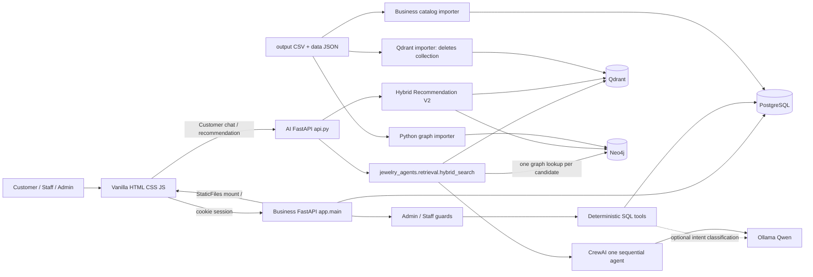
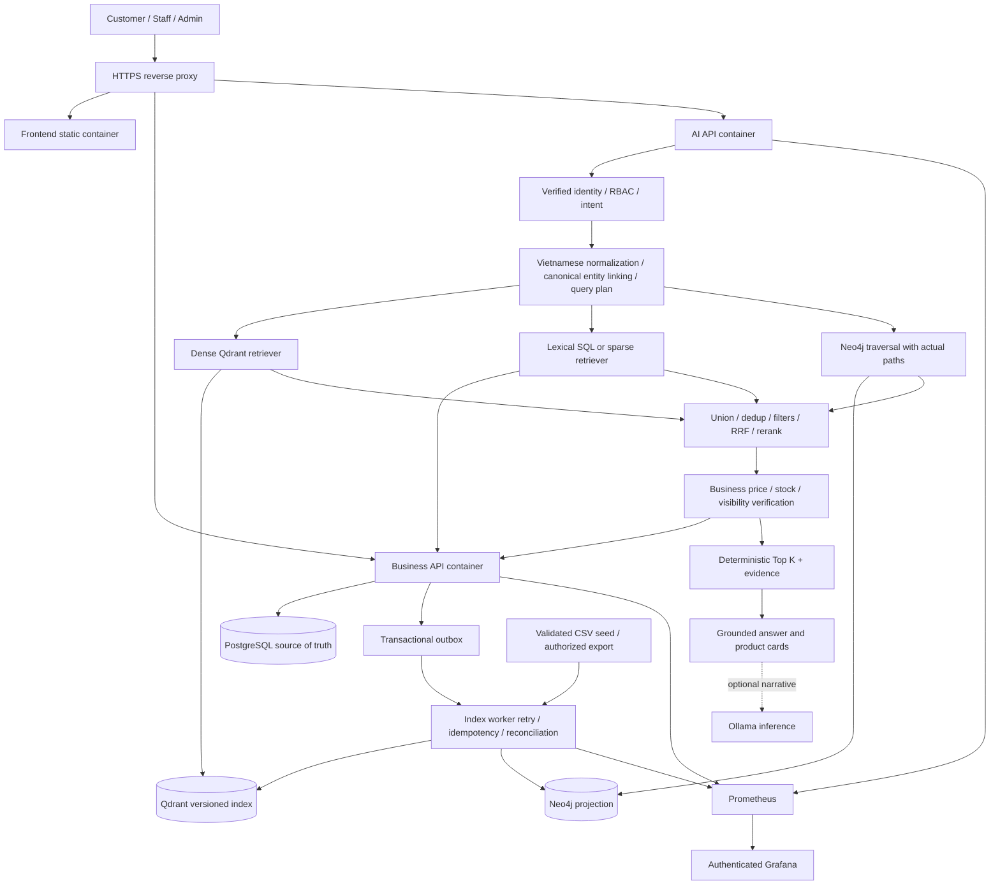

# LUMIÈRE — PHASE 0: AS-IS, TO-BE và Gap Analysis

Ngày audit: 18/11/2026 (Asia/Bangkok). **Trạng thái: partially audited, chưa đạt gate toàn bộ PHASE 0.**

Mốc hiện tại 21/11: xem `12-acceptance-status.md` và `current-implementation.json`; các baseline bên dưới là lịch sử. Bổ sung sơ đồ core ERD/query/CSV/outbox/use cases từ source tại `14-source-based-diagrams.md`. Đã rà lại các model Product/Order/OrderItem/Payment/Cart/Session và public recommendation: mặc định mới không dùng customer_id do client gửi để đọc history CSV, có adapter giữ cards và revalidate live facts. Legacy opt-out vẫn có giới hạn ownership đã nêu trong bảng GAP, không dùng cho public deployment chưa review.

## Cập nhật sau khi chuyển thư mục tạm sang ổ D

**Cập nhật mới nhất:** writer CSV→Neo4j đã chạy thật hai lần cho 500 bản ghi/2.500 cạnh trên instance Community riêng, không duplicate; test rollback và graph paths đạt. Đã tích hợp chat hybrid/live-price verification, aliases tiếng Việt, versioned Qdrant và kiểm thử API. Xem [tiến độ dễ đọc](05-progress-plain-language.md), [pipeline CSV](03-csv-ingestion.md), [luồng tìm kiếm](04-hybrid-retrieval.md). Những đoạn baseline/AS-IS phía dưới là lịch sử trước sửa, không phải trạng thái code mới.

Baseline pytest đầy đủ đã chạy thành công: **633 tests, 827 subtests passed**, 1 warning trong 121.84s. Đã tạo branch riêng và checkpoint checksum 7 file liên quan, giữ nguyên thay đổi business/frontend sẵn có. Chi tiết tại [safe foundation progress](01-safe-foundation-progress.md). Bổ sung preflight CSV vào importer hiện có: 10 test pass, dry-run **500/500 record hợp lệ**, chưa ghi database; xem [CSV ingestion](03-csv-ingestion.md) và [report](csv-preflight-baseline.json).

Các phần AS-IS/baseline phía dưới giữ lại trạng thái tại thời điểm khảo sát ban đầu. PHASE 0 vẫn chưa được đánh dấu hoàn tất review từng file. PHASE 1 đang chuẩn bị, PHASE 2 mới có validation/dry-run/constraint source; các gate DB live, graph idempotency, frontend E2E, fault injection và evaluation vẫn chưa đạt.

## CURRENT — phạm vi và giới hạn bằng chứng

Đã đọc toàn bộ `MASTER_PROMPT_LUMIERE_AI_REBUILD_VSCODE.md` bằng UTF-8; không tìm thấy `AGENTS.md` trong danh sách tìm kiếm workspace. Đã đọc source các entrypoint, toàn bộ business routers, auth/session/password reset, core database/security, các model Product/Order/OrderItem/PaymentTransaction/User, transaction checkout/payment/dashboard, AI tools chính, customer retrieval/RAG/CrewAI, graph import/query/recommendation, Qdrant importer, frontend API/widget và các điểm gọi recommendation, migration nền, CI hiện có và cơ chế test.

**Chưa tuyên bố đã đọc chi tiết từng file Frontend/Backend/AI:** các service/schema/model phụ, tất cả migration/test, mọi template HTML/CSS và các bản prototype còn cần review tiếp. `source-inventory.json` chỉ kiểm kê/hash/parse cú pháp, không thay thế semantic review. Không đồng nhất “có code” với “chạy được”. Không truy cập DB live, không xác nhận schema/collection đang chạy, vector count, model cache, deployment hay dữ liệu giảng viên ngoài workspace. Không đọc hoặc in nội dung `.env`, CSV khách hàng/đơn hàng. Không sử dụng network để gửi source đi ngoài.

Git lúc bắt đầu:

- Branch: `feature/ai-admin-staff-enhancement`.
- HEAD: `cb645852891748b045ac966cb1a18df637c50554`.
- Modified trước audit: `backend/app/main.py`, `frontend/pages/forgot-password.html`.
- Untracked trước audit: đặc tả, password-reset backend/frontend, script/test chẩn đoán, nhiều `.bak`, hai file có tên giống lệnh shell lỗi. Giữ nguyên toàn bộ; không add/commit/reset/stash.
- Không tạo branch/worktree hay checkpoint backup toàn bộ dữ liệu. HEAD đơn thuần **không** khôi phục được nội dung dirty/untracked. Chưa đủ điều kiện sửa runtime.

## Cấu trúc thực tế

```text
AI/
  api.py; config.py; import_qdrant.py; prepare_products.py; embedding.py
  hybrid_recommendation.py; hybrid_recommendation_v2.py
  jewelry_agents/{retrieval,crew,agents,tasks,tools,hybrid_retrieval}.py
  rag/{rag_service,context_builder,retriever}.py
  knowledge_graph/{import_data,connection,graph_queries,graph_recommendation}.py
  knowledge_graph/schema.cypher
  tests/test_price_intent.py
backend/
  app/{main,import_catalog,init_db}.py
  app/{core,models,schemas,routers,services}/
  alembic/versions/                 # 0001 → 0007 contact
  tests/                          # unittest và pytest trộn lẫn
frontend/
  assets/{js,css,images}/; pages/{admin,staff}/; index.html
  tests/e2e/lumiere.spec.js; playwright.config.js; package.json
Website/                          # prototype riêng, không mount bởi Business API
data/                             # lookup JSON
output/                           # CSV seed/AI/recommendation
generators/; utils/; config/; scripts/
docker-compose.yml                # chỉ PostgreSQL
.github/workflows/                # Final Demo Verification
```

## AS-IS Architecture



Business API không gọi Customer AI để checkout/login. Tuy nhiên frontend đang được serve bởi Business API; chưa có lifecycle frontend độc lập. Không có bằng chứng fault isolation thực nghiệm chỉ từ sơ đồ/source.

## Requirement → bằng chứng → trạng thái

`verified` chỉ áp dụng cho phép kiểm tra cụ thể đã thực hiện. `exists-not-tested` nghĩa là source có tồn tại nhưng hành vi end-to-end chưa được xác nhận.

| Yêu cầu | Source/function | Trạng thái / kết luận |
|---|---|---|
| Login/register/profile/logout | `backend/app/routers/auth.py:get_current_user/login/register` | exists-not-tested end-to-end; cookie session hash SHA-256 trong DB, password Argon2 qua pwdlib; **không phải JWT** |
| Password reset | `backend/app/routers/password_reset.py` | exists-not-tested; file untracked, model trong router; chưa thấy Alembic revision cho bảng; demo mode in reset URL vào terminal |
| Catalog và quyền quản lý | `backend/app/routers/catalog.py` | exists-not-tested live; public GET, Admin CRUD, Staff/Admin stock CAS |
| Cart/checkout/order/payment | `routers/{cart,orders,payments}.py`, `services/{orders,payments}.py` | có ownership, transaction, lock order, snapshot giá và kiểm tra IPN; subset unittest có chạy, chưa smoke E2E |
| Admin/Staff AI | `routers/ai_admin.py`, `routers/ai_staff.py`, `routers/orders.py:admin/staff_or_admin` | exists-not-tested toàn ma trận; guard backend thật; SQL tools tái sử dụng nghiệp vụ |
| Doanh thu, bán chạy | `services/ai_admin_analytics.py:get_top_selling_products`, `services/dashboard.py:classify/revenue` | SQL/payment verification, không dùng embedding tính doanh thu; lọc theo verified_at và timezone Việt Nam |
| CSV → graph bằng Python | `AI/knowledge_graph/import_data.py:import_products` | exists-not-tested; `UNWIND $rows`, `MERGE product_id`; **không thiếu pipeline Python hoàn toàn** |
| Schema graph | `AI/knowledge_graph/schema.cypher` | file rỗng; search source graph không thấy CREATE CONSTRAINT/INDEX |
| Entity linking tiếng Việt | `AI/jewelry_agents/retrieval.py:extract_category/extract_material/extract_gemstone` | rules hardcode; chưa có canonical Audience, alias dataset, context/ambiguity hoặc semantic entity linking |
| Dense retrieval | `AI/import_qdrant.py`, `AI/jewelry_agents/retrieval.py:search_qdrant` | model khai báo `paraphrase-multilingual-MiniLM-L12-v2`, 384, COSINE; runtime collection/model chưa xác minh |
| Hybrid chat | `retrieval.py:hybrid_search` | dense candidate search + graph enrichment + rules; chưa là dense+lexical rank fusion |
| Top-K chat | `retrieval.py:hybrid_search` dòng 367,396,583,592 | pool max(7K,35), score sort và slice K có; chưa parse K từ câu, dedup/tie-break/live check chưa đủ |
| Graph recommendation | `knowledge_graph/graph_recommendation.py:GraphRecommender.recommend` | có traversal shared Category/Material/Gemstone; trả score, chưa trả path evidence; chưa có Style |
| Hybrid recommendation V2 | `AI/hybrid_recommendation_v2.py:recommend_v2` | có normalized weighted content/dense/collaborative/graph, stock từ CSV; chưa benchmark/cross-encoder |
| Grounded answer | `AI/rag/rag_service.py:answer_jewelry_question/build_safe_answer` | fallback deterministic khi LLM lỗi hoặc nói no-result; chưa validate mọi sản phẩm/giá trong LLM answer |
| Đồng bộ | `catalog.py:create_product/update_product/update_stock`, checkout/cancel | chưa thấy outbox/retry/reconciliation projection |
| Docker độc lập | `docker-compose.yml` | chỉ postgres:17 với localhost 5433, volume, healthcheck; chưa có Dockerfile 3 khối |
| CI | `.github/workflows/` | có check JS/compile và hai nhóm unittest; push chỉ branch cũ; chưa paths/image build/deploy |
| Monitoring/hosting | search source + compose | chưa thấy Prometheus/Grafana/proxy deployment trong phạm vi kiểm kê |
| Evaluation | `generators/evaluate.py`, các script recommendation/test | chưa xác nhận benchmark >=100 query gán nhãn, split/ablation/metrics yêu cầu |

## Gap Analysis theo ưu tiên

| Ưu tiên | Vấn đề / bằng chứng | Tác động | Cách xử lý ít xâm lấn |
|---|---|---|---|
| P0 | `AI/import_qdrant.py:30–31` xóa collection đang có, thực thi ngay khi import module | mất index nếu chạy nhầm | không chạy; chuyển sang CLI dry-run và collection versioned sau checkpoint |
| P0 | `retrieval.py:513` khởi tạo price_ok=True, bỏ qua kiểm tra khi Price=None | lọt sản phẩm thiếu giá khi có budget; probe tái hiện 1/0 | fail closed cho hard filters; Business API live verification |
| P0 | `retrieval.py:hybrid_search` không lọc Stock ở dense branch | có thể gợi ý hết hàng; probe tái hiện 1/0 | lọc và xác minh lại stock live, không dùng graph/CSV làm nguồn giá giao dịch |
| P0 | `rag_service.py` chỉ kiểm tra vài câu no-result trong narrative | LLM vẫn có thể thêm/sửa tên/giá | structured answer validation/deterministic cards, giữ ranking từ server |
| P0 | `api.py` recommendation nhận customer_id do client cấp, chưa có session guard | không đủ bảo đảm customer-owned personalization | audit data exposure thực tế; adapter auth nội bộ, không mở Customer order tool thiếu ownership |
| P0 | dirty tree + thiếu baseline pytest đầy đủ | không bảo đảm rollback/regression | snapshot có kiểm soát, unified offline test runner, không commit nội dung user tùy tiện |
| P1 | graph importer không CLI/dry-run/validation/batch/retry/report; toàn bộ DataFrame vào một query; schema file rỗng | khó replay/đối soát, duplicate/concurrency và partial import chưa kiểm chứng | nâng cấp importer hiện có, product-only mặc định, stable IDs/constraints/lineage |
| P1 | graph importer MERGE quan hệ mới không gỡ quan hệ taxonomy cũ khi đổi FK | tồn tại đồng thời các fact cũ/mới | projection ownership/version, thay fact có kiểm soát; không xóa relationship ngoài phạm vi |
| P1 | graph hiện dùng `HAS_BRAND`, `IN_COLLECTION` | đổi tên cạnh ngay sẽ phá truy vấn hiện có | giữ adapter/schema mapping trước khi migrate; không đổi đồng loạt |
| P1 | CSV sản phẩm không có Audience/Style/Occasion; lookup chỉ 5 nhóm | không có bằng chứng cho cạnh phái nữ/thanh lịch | thêm nguồn catalog có provenance; fixture giả lập riêng, không gán giới tính theo tên/ảnh |
| P1 | thiếu lexical/BM25/RRF trong chat; graph enrichment N+1 | retrieval chất lượng/latency chưa kiểm chứng | tái sử dụng business catalog lexical, batch graph, RRF; rerank theo evaluation |
| P1 | Qdrant/Neo4j/model init lúc import, Qdrant lỗi không catch trong chat | dependency lỗi có thể khiến AI không start/request lỗi | lazy lifecycle, timeout, controlled fallback; liveness khác readiness |
| P1 | fallback Neo4j là giá tăng dần với score=0, chỉ chạy nếu dense không có kết quả; không bắt Qdrant exception | không phải semantic ranking/fault fallback | response ghi nguồn fallback, không tự nhận dense score |
| P1 | “dưới 8 triệu” đang dùng <=; K câu hỏi không override API top_k | ranh giới hard filter/count sai ngữ nghĩa | query plan có inclusive/exclusive, tests Top1/3/5 + tie/dedup |
| P1 | `run_safe.py` unittest không collect test hàm pytest, thiếu pytest trong dependencies backend | baseline có thể bỏ sót AI role tests ngay cả khi import thành công | runner pytest có guard DB/network và kiểm tra số lượng collection |
| P1 | password reset mới chưa migration/rate limit; demo log có token | cần harden trước public hosting | giữ thay đổi user, bổ sung regression/migration sau backup; demo off khi deploy |
| P1 | compose chỉ postgres, backend mount frontend; AI localhost cứng ở nhiều module | chưa đạt service isolation/container DNS | thêm images/network/proxy theo phase, giữ URL contract |
| P2 | thiếu metric/dashboard/CI image/staging/benchmark gán nhãn | chưa có chứng cứ chất lượng và vận hành | instrument thật, human-reviewed dataset và ablation, CI staging với approval production |

## TEST — baseline đã thực thi

1. `node --check` trên **21 file** trong `frontend/assets/js`: **21 pass, 0 fail**. Chỉ là syntax, không chứng minh hành vi DOM/E2E.
2. Python mặc định trong sandbox không truy cập được. `AI/.venv/Scripts/python.exe` chạy ngoài sandbox là Python **3.11.9**, nhưng thiếu `sqlalchemy`.
3. Environment được `FINAL_DEMO_SETUP.md` tham chiếu: `D:\JewelryDatasetGenerator\.venv\Scripts\python.exe` có SQLAlchemy/FastAPI/Neo4j/Qdrant/Sentence Transformers, **thiếu pytest**. Không cài hay sửa environment này.
4. Chạy `backend/tests/run_safe.py` với `POSTGRES_DB=lumiere_audit_test_only`, password giả, `PYTHONPATH=.`, `PYTHONDONTWRITEBYTECODE=1`. Runner patch `dotenv.load_dotenv`, chỉ cho SQLAlchemy Engine kết nối SQLite `:memory:`. Kết quả: **Ran 566 tests in 76.450s; FAILED(errors=11); Passed subtests:827.** 11 lỗi import `pytest`; 555 mục còn lại không báo fail. Đây là unittest discovery, không phải toàn bộ pytest suite. Guard này chưa chặn mọi loại network; không suy diễn sandbox mạng tuyệt đối.
5. Probe AST lấy các hàm thật của `retrieval.py`, không import module/model, dùng fixtures giả: missing price 1 thay vì 0; stock=0 trả 1 thay vì 0; giá =8.000.000 cho “dưới 8 triệu” trả 1 thay vì 0; Qdrant outage ném ConnectionError. **4 lỗi tái hiện.** Probe không chứng minh Qdrant/Neo4j live.

Lệnh tái lập probe và inventory (không DB, không model):

```powershell
python -B scripts/probe_retrieval_baseline.py
# Exit 1 là các lỗi đã được tái hiện, không phải test pass.
python -B scripts/audit_workspace.py
python -B scripts/audit_workspace.py --report docs/evidence/source-inventory-new.json
```

Lệnh baseline backend hiện có (dùng interpreter đã cài đúng dependency):

```powershell
$env:POSTGRES_DB='lumiere_audit_test_only'
$env:POSTGRES_PASSWORD='audit_placeholder'
$env:PYTHONDONTWRITEBYTECODE='1'
$env:PYTHONPATH='.'
Set-Location backend
python -B tests/run_safe.py
```

Chưa chạy Playwright, checkout/signup/write smoke, import graph/vector, migration, stop/start container, public deployment. E2E có guard `LUMIERE_E2E_DB_KIND=isolated` và cờ write, nhưng chưa có test stack độc lập được xác nhận. Không tự bật các cờ đó trên database hiện tại.

## TO-BE Architecture



Admin/Staff analytics tiếp tục dùng SQL tools và backend role guards; không đưa doanh thu vào semantic ranking. Business checkout giữ nguyên transaction/stock/payment logic. AI outage không nằm trong dependency chain của business; graph/vector/LLM outage có policy fallback công khai đúng nguồn. Việc frontend được serve độc lập không thay đổi API hợp đồng hiện hữu.

Dependency map triển khai: baseline + snapshot → catalog contract → validated graph projection → entity linking → dense/lexical/graph fusion → live verification/Top-K → sync/RBAC → containers/fault tests → monitoring/CI/staging → evaluation. Không coi graph `Audience/Style` tồn tại khi nguồn chưa cung cấp.

Tài nguyên chỉ là dự toán ban đầu cần đo: web/business worker cần một phần CPU/RAM riêng; Qdrant memory phụ thuộc vector count/payload và index, Neo4j cần heap/page cache, PostgreSQL cần memory/IO; Ollama/Qwen cần benchmark model/quantization/context/concurrency trên CPU/GPU thật. Có thể thử host ứng dụng/data riêng inference; chưa chọn/mua VPS/domain và không ghi giá nhà cung cấp chưa xác minh. Chưa đủ bằng chứng để cam kết một VPS cụ thể hay latency.

## CHANGE / COMPATIBILITY / RISK / ROLLBACK

Giai đoạn read-only thực hiện trước mọi file mới. Sau đó chỉ tạo tài liệu, inventory tool và probe tái lập audit; **không sửa runtime, data, config thật hay file đã có thay đổi của người dùng**. Các công cụ mới không import application; báo cáo inventory không chứa source text/secret/PII. Test của utility dùng thư mục tạm.

Compatibility: không có thay đổi runtime; chưa có smoke E2E xác nhận toàn workflow. Rủi ro hiện hữu được giữ nguyên, chưa tuyên bố khắc phục. Công cụ probe lưu lại defect, không tự sửa hoặc kết nối DB.

Rollback phần bổ sung: chỉ loại bỏ đúng các file mới của đợt audit sau khi xác nhận chúng chưa bị người dùng chỉnh thêm. Không dùng reset/clean, không rollback database, không xóa volume. Chưa tạo checkpoint phục hồi dirty source, vì chưa sửa các file đó.

## NEXT — phase checklist và điều kiện tiếp tục

- [ ] PHASE 0: hoàn tất review từng file còn lại, thống kê coverage; unified baseline đầy đủ; DB schema/collection read-only chỉ khi có quyền/môi trường xác định. Không đánh dấu done từ inventory.
- [ ] PHASE 1: branch/worktree khi an toàn; backup **dirty/untracked source liên quan** có checksum và private location; không commit `.bak`/secret; setup interpreter/dependency test riêng, pytest runner chặn DB/network; regression password reset.
- [ ] PHASE 2: nâng cấp `AI/knowledge_graph/import_data.py` và schema hiện hữu; parse CSV ProductID và lookup thực; UTF-8-SIG/NFC/Decimal/duplicate/FK; dry-run mặc định; batched parameterized MERGE/constraints/lineage/report; test idempotency hai lần trên **Neo4j dev trống xác nhận**. Không chạy importer cũ trên graph chưa phân loại.
- [ ] PHASE 3: aliases versioned + context/ambiguity/child age; canonical entities theo nguồn thật. Không bịa Audience/Style từ CSV không có cột.
- [ ] PHASE 4: versioned dense indexing, lexical candidate source, graph traversal, union/dedup/RRF; benchmark trước khi đổi embedding và reindex.
- [ ] PHASE 5: fix hard filters/live stock-price, parse K, deterministic tie-break, paths/recommendation, grounded output; compatibility adapter giữ cards hiện tại.
- [ ] PHASE 6: outbox transactional, retry/DLQ/reconcile; ma trận role, customer-owned personalization/order tools.
- [ ] PHASE 7: Dockerfile Frontend/Backend/AI độc lập; separate dev compose volumes/project; health/live và ready; fault matrix có kết quả thật.
- [ ] PHASE 8: Prometheus/Grafana, CI theo paths, image SHA, staging/recovery runbooks. Public deploy/budget/secret changes theo phê duyệt riêng.
- [ ] PHASE 9: >=100 queries được người review gán nhãn; split và ablation; metrics/report/chart từ dữ liệu thật, demo/Q&A.

Staging/backup: tên Compose project, ports, credentials, database và volumes tách hẳn bản hiện tại; dùng fixture giả trước. Trước mọi export/restore/import cần xác định nguồn/đích và quyền dữ liệu; backup PostgreSQL bằng pg_dump, Neo4j bằng phương thức backup tương thích version, Qdrant snapshot, kiểm tra restore ở stack riêng. **Đây là hướng dẫn, chưa thực hiện hoặc xác nhận backup nào.** Không dùng `down -v`, DROP, TRUNCATE, DETACH DELETE toàn graph hoặc ghi production.
