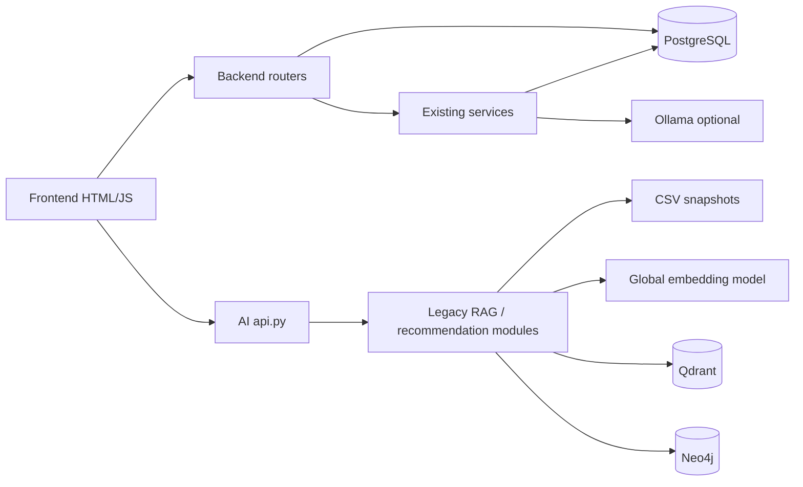

# LUMIÈRE — audit và trạng thái nghiệm thu

Ngày kiểm tra: 18–19/11/2026. Checkpoint: `cb64585`, nhánh local
`checkpoint/pre-architectural-refactor-20261118`. Working tree sạch trước khi sửa.
Không tạo commit migration lớn, không ghi database production hoặc triển khai production.

**Cập nhật 19/11/2026:** Master Prompt gốc đã được bổ sung tại root và được đọc đầy đủ
(mục 1–19, thêm mục 0 bối cảnh). Lần refactor trước dùng bản đính kèm 14 phần;
đối chiếu bổ sung và các gap mới nằm trong `docs/08-master-prompt-conformance.md`.

## Bằng chứng từ source

| Nhận định | Bằng chứng và kết luận |
| --- | --- |
| Business logic trong router | Router cart trước migration có SQL, serialization, khóa và commit/rollback. `staff_ai_chat` dài 192 dòng, `admin_ai_chat` dài 178 dòng tại thời điểm audit. Có vấn đề thực tế. |
| Backend hoàn toàn procedural, không có service | **Không đúng toàn bộ:** đã có `services/orders.py`, `payments.py`, `coupons.py`, orchestrators; SQLAlchemy models và Pydantic schemas đã có. Giữ lại thay vì viết lại máy móc. |
| Repository/DI | Backend đã dùng `Depends(get_db)` và cookie auth. Cart chưa có repository interface hoặc application service trước migration. |
| AI coupling | `AI/api.py` import recommendation/RAG; tiếp tục import model, Qdrant và Neo4j ở module scope. CSV đọc theo working directory. |
| Hàm AI quá lớn | `jewelry_agents/retrieval.py` 874 dòng, `hybrid_search` 234 dòng, `extract_price_filter` 222 dòng; `jewelry_agents/hybrid_retrieval.py` có `hybrid_search` 256 dòng. |
| Logic retrieval trùng | Có các pipeline trong `AI/hybrid_retrieval.py`, `jewelry_agents/retrieval.py`, `jewelry_agents/hybrid_retrieval.py`, các bản backup và recommendation. Chưa xóa vì còn callers/luồng thử nghiệm. |
| Cấu hình hardcode | Graph connection/import cũ hardcode URI localhost; nhiều CSV paths `../output`. Password hiện đã lấy từ environment ở checkpoint. |
| Graph ingestion | Import cũ đã dùng MERGE/stable ProductID, không phải chưa có KG. Chưa có validation toàn catalog, uniqueness constraints, verification và thay relationship khi taxonomy đổi. |
| Vector import | `AI/import_qdrant.py` xóa collection cũ nếu tồn tại. Pipeline mới không gọi script đó và không xóa collection. |
| Frontend | HTML/CSS/JS thuần; page controllers và global API client đã có. `site.js` 781 dòng, `backend-console.js` 740 dòng. Không cần chuyển framework. |
| Phân quyền | Staff/Admin APIs đã có guards; không tái thiết kế auth/schema. Regression gồm role access matrix và scope safety. |
| DevOps | Compose cũ chỉ có PostgreSQL; workflow cũ compile, syntax và một phần test. Chưa có runtime độc lập đầy đủ cho staging trước thay đổi này. |

## Ma trận yêu cầu và gap còn lại

DONE nghĩa là hoàn tất phần có phạm vi ghi rõ; không đồng nghĩa production ready.

| Yêu cầu | Trạng thái | Bằng chứng / phần còn thiếu |
| --- | --- | --- |
| Đọc Master Prompt | DONE | Bản gốc đã bổ sung và đọc đầy đủ; xem docs 08 về đối chiếu 19 mục. |
| Audit, dependency map, checkpoint | DONE | Tài liệu 00–03; checkpoint Git tồn tại. |
| Clean Architecture backend | PARTIAL | Cart đã migration, regression PASS. Auth/catalog/orders/payments và Staff/Admin orchestration chưa chuyển hết sang ports/adapters. |
| Giữ API/schema/auth | DONE trong regression | 60 business paths OpenAPI bằng baseline; 6 AI paths bằng schema checkpoint. Không sửa models/Alembic hoặc hành vi auth; shared auth/role dependencies chuyển vào core. PostgreSQL runtime vẫn chưa kiểm chứng. |
| AI service/ports/DI | DONE cho engineering acceptance | `AI/lumiere`; DI/lazy model; HTTP chat dùng real model + Neo4j + Qdrant local PASS. Production/E2E UI chưa nghiệm thu. |
| CSV/Postgres → Neo4j | VERIFIED cho CSV test; PostgreSQL PARTIAL | Import/replay/verify 500 nguồn + 8 fixture, provenance, batches/resume PASS. PostgreSQL live chưa đọc. |
| Vietnamese semantic entity linking | VERIFIED chức năng; quality PENDING_REVIEW | Versioned aliases, NFC, negation/bác, age context, cosine threshold/margin, ambiguity. Chưa có human truth để đo accuracy. |
| Real embeddings / Qdrant | VERIFIED local SDK | Model multilingual 384 chiều, 508 real vectors, cosine collection/readback/replay/filtering PASS; Qdrant server/container chưa kiểm chứng. |
| Dense + lexical + graph fusion | VERIFIED engineering | Weighted RRF, filters, rerank, revalidation/Top-K và phối hợp ba nguồn live/HTTP PASS; chưa có relevance benchmark. |
| Graph path recommendation/explanation | VERIFIED test | Hai-hop seeded cùng đá/phong cách, paths thực và chống stale evidence PASS; graph của catalog gốc chưa có optional facts. |
| Exact Top-K | DONE cho quy tắc đã test | Backfill từ authoritative catalog sau filtering, khi có tín hiệu retrieval và đủ hàng hợp lệ. Không trả hàng tùy ý cho truy vấn hoàn toàn không nhận diện. |
| Grounded response | DONE cho modular template | Tên/ID/giá lấy từ catalog; không nhận facts do LLM bịa. LLM generation mới và semantic quality evaluation còn thiếu. |
| PostgreSQL/Qdrant/Neo4j sync | PARTIAL | Explicit replayable sync CLI, không giả định atomic across stores. Chưa có outbox/CDC, delete propagation hoặc tự động đồng bộ liên tục. |
| Frontend refactor | PARTIAL | Tách HTTP transport thành ES module, API global facade giữ nguyên. 5 unit tests + syntax PASS. Controllers/state/session chưa migration toàn bộ; browser E2E chưa chạy. |
| Containers/health/network/volumes | PARTIAL | Dockerfiles riêng, staging Compose config PASS. Images chưa build và containers chưa start vì daemon không chạy. |
| Monitoring / structured logging | PARTIAL | Backend request logs/metrics, AI chat/source metrics; Prometheus/Grafana config. Chưa xác minh scrape/dashboard live. |
| CI/CD | PARTIAL | Workflow quality gates đã viết; chưa chạy trên GitHub. Chưa có auto-deploy hoặc production pipeline. |
| Unit/API/RBAC/fault tests | DONE cho các ca đã chạy | Kết quả và lệnh trong tài liệu 06. |
| Live integration / performance / evaluation | VERIFIED engineering / quality PENDING_REVIEW | Model/graph/local vector HTTP đã chạy; 136 benchmark candidates chưa duyệt, evaluator CSV/JSONL chặn pending. PostgreSQL/container/browser chưa kiểm chứng. |
| Deployment/rollback/data preservation | DONE cho runbook; runtime PARTIAL | Không dùng volume cũ; không xóa source/data; tài liệu 07. Chưa restore backup hay rollback một deployment thật. |

Không tuyên bố toàn bộ rebuild đã DONE. Các phần còn lại có thứ tự thực hiện và
điều kiện chuyển luồng trong tài liệu 02.
