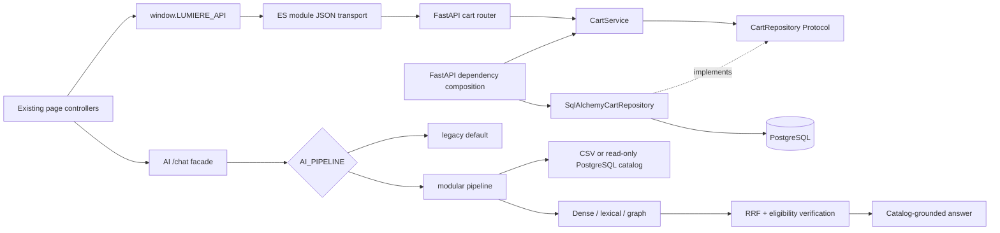

# Kiến trúc mục tiêu và quyết định triển khai

Giữ hai Python runtimes và frontend hiện hữu. Chọn modular monolith cho backend;
AI là service độc lập. Không tạo các thư mục module rỗng hay một class cho mỗi function.

## Backend

`domain/cart.py` có domain error, stock rule và repository Protocol, không import
FastAPI/SQLAlchemy. `application/cart.py` phối hợp use cases và tính Decimal subtotal.
`infrastructure/cart.py` sở hữu ORM queries, khóa và transaction. Router giữ nguyên
schemas/dependencies auth, chuyển domain errors sang status/detail cũ.

Session vẫn là dependency cache dùng chung với auth. Mutation khóa user trước product,
commit một lần và rollback trên lỗi. Không thay bằng `Session.begin()` lồng vào transaction
đã được auth mở; không thêm reservation tồn kho trong cart.

Các module cũ tiếp tục hoạt động; không ép chuyển toàn bộ backend chỉ để đồng bộ tên thư mục.

Cookie authentication và role guards dùng chung nằm trong `core/dependencies.py`;
pagination/ID constraints trong `core/api_parameters.py`. Business routers không import
guards từ router Orders nữa. `routers/auth.py` và `routers/orders.py` giữ compatibility
exports của dependencies cũ, không tạo wrapper thay đổi callable identity.

## AI

`domain.py` có immutable product facts và `ProductRepository`, `Retriever`, `Embedder` ports.
`catalog.py` chứa CSV/Postgres adapters và validation. `understanding.py` xử lý aliases,
normalization và giá; `retrieval.py` chứa eligibility, lexical retrieval, fusion và grounded
answer. `adapters.py` chứa Qdrant, Neo4j, SentenceTransformer adapters. `ingestion.py`
phối hợp validated upserts. `bootstrap.py` là composition root.

Mỗi request có catalog snapshot nhất quán và clients ngắn hạn được đóng sau sử dụng.
Model được lazy load và giữ trong provider thuộc `app.state`, có lock khởi tạo; không
download model khi import API. Constructor injection cho phép kiểm thử core không có services.

Runtime mặc định vẫn `AI_PIPELINE=legacy`. `modular` là opt-in ngoài isolated staging Compose.
Modular pipeline không dùng customer/order/cost facts, không mở thêm Staff/Admin APIs.

## Deployment boundaries

Frontend Nginx chạy port 8080, chuyển `/api/` đến backend, `/ai/` đến AI. Runtime config
được chèn trước deferred page scripts; dùng cùng origin cho cookie auth. Backend mặc định
vẫn serve frontend như trước; container đặt `SERVE_FRONTEND=false`.

Staging có project/volumes mới. PostgreSQL là source of truth khi `AI_CATALOG_SOURCE=postgres`;
CSV chỉ là snapshot offline/demo. Graph/vector là derived indexes; không tin giá/tồn kho
trong payload khi trả kết quả. Outbox và continuous sync là giai đoạn tiếp theo, chưa triển khai.
