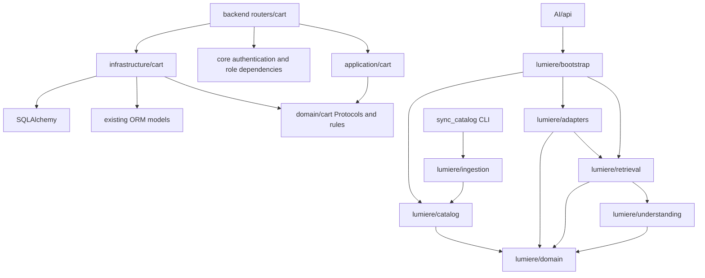

# Dependency map và request boundaries



Domain cart không import infrastructure/presentation. AI core không import SDK hoặc
backend. SDK imports nằm trong adapters/lazy resources. `adapters` dùng eligibility
predicate của retrieval để push down filters, không có import ngược từ retrieval
vào adapters. Hai service không import code của nhau.

```mermaid
sequenceDiagram
  actor Customer
  participant Router as Cart Router
  participant Auth as Existing Auth dependency
  participant Service as CartService
  participant Repo as SQLAlchemy Repository
  participant DB as PostgreSQL
  Customer->>Router: POST /cart/items + cookie
  Router->>Auth: get_current_user (shared Session)
  Auth->>DB: Validate session/user
  Router->>Service: add(user.id, product_id, quantity)
  Service->>Repo: mutation(user.id)
  Repo->>DB: SELECT user FOR UPDATE
  Service->>Repo: find cart/item; lock product
  Repo->>DB: SELECT product FOR UPDATE
  Service->>Service: Accumulate quantity; check stock
  Service->>Repo: flush; read items
  Service->>Service: Build Decimal subtotal
  Repo->>DB: COMMIT (or ROLLBACK on failure)
  Service-->>Router: Cart DTO
  Router-->>Customer: Existing CartResponse
```

Coupling giữa business routers qua auth/Orders guards đã được loại bỏ; shared dependencies
và API parameter aliases nằm trong core. Auth/orders giữ compatibility exports cùng
callable identity. Services cũ còn dùng HTTPException/ORM; frontend pages vẫn dùng global
session/UI helpers. Đây là phạm vi migration tiếp theo, không ghi là đã tách hoàn toàn.
