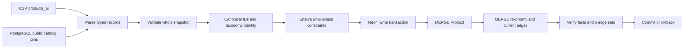
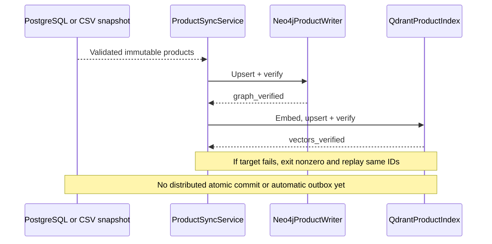

# Knowledge Graph và ingestion contract

Giữ labels/relationship names tương thích importer/query hiện có:

| Label | Stable key | Public properties được cập nhật |
| --- | --- | --- |
| Product | product_id = CSV ProductID / PostgreSQL products.id | sku, name, sale_price, stock |
| Category | category_id | name |
| Brand | brand_id | name |
| Material | material_id | name |
| Gemstone | gemstone_id | name |
| Collection | collection_id | name |

`Product` có `BELONGS_TO→Category`, `HAS_BRAND→Brand`, `MADE_OF→Material`,
`HAS_GEMSTONE→Gemstone`, `IN_COLLECTION→Collection`. Mỗi taxonomy facet có một
quan hệ hiện hành. Graph writer tạo uniqueness constraints theo stable key.
Không tự đổi ProductID thành hash/sequence; không đưa customer PII hoặc giá vốn vào pipeline mới.

Validation từ chối catalog rỗng, product ID/SKU trùng, taxonomy ID có tên xung đột,
ID không dương, giá NaN/Infinity/âm, stock âm và tên rỗng. Toàn bộ snapshot được
validate trước khi ghi bất kỳ target nào. Giá được giới hạn theo Numeric(18,2), IDs/stock theo
Integer. Validation hiện chưa thay thế toàn bộ string-length limits của PostgreSQL; nguồn
production phải là catalog đã qua DB constraints. Modular product có `PriceVND` dạng chuỗi
Decimal chính xác ngoài trường `Price` số tương thích cũ; template dùng chuỗi chính xác này.

Neo4j upsert dùng parameters cho values; labels/types chỉ từ hằng số. Khi taxonomy
của một product đổi, chỉ xóa edge cũ thuộc facet đó và nối edge mới. Không xóa Product,
không xóa taxonomy nodes, không đụng Customer/Order edges của graph cũ. DDL constraints
chạy trước write transaction; nếu verification facts/edges lệch, transaction data rollback.

Qdrant index mới `lumiere_products_v2` dùng point ID bằng ProductID và embeddings
SentenceTransformer normalize. Kiểm tra vector count/dimensions/finiteness, dimension
collection hiện có, upsert `wait=True` và đọc lại public payload để verify. Không gọi
`delete_collection`. Model identity nằm trong payload và filter khi retrieval.
Thay model nên dùng collection mới dù vector dimension giống nhau.

`python AI/sync_catalog.py` chỉ validate; `--apply` mới ghi. Đây là manual/replayable
sync, không phải CDC. Product bị xóa có thể còn trong derived index; runtime xác minh
ID/giá/tồn kho từ catalog để loại stale products. Delete cleanup/revision lag detection
còn thiếu. Neo4j Community test server đã chạy import/replay/update/verify trên 508 records;
xem `evidence/ai-live-acceptance.json`, `knowledge-graph-schema.md` và
`csv-to-knowledge-graph.md` cho schema optional evidence, batches/resume và lệnh hiện tại.
