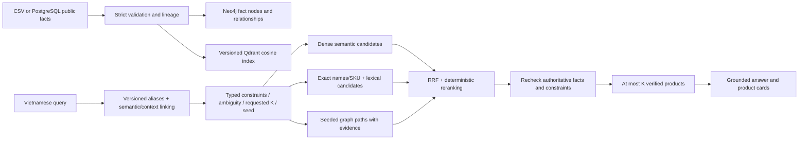

# Đối chiếu Master Prompt gốc và continuation ledger

Nguồn: `MASTER_PROMPT_LUMIERE_AI_REBUILD_VSCODE.md`, đã đọc toàn bộ các mục 1–19
và mục 0 bối cảnh, ngày 19/11/2026. Tài liệu này thay thế nhận định thiếu Master Prompt
trong lần audit trước. Giữ nguyên checkpoint `cb64585` và toàn bộ refactor đã có.
Snapshot bổ sung: `.cache/checkpoints/preserved-refactor-before-master19-20261119T053116Z.zip`,
75 files, từng file được xác minh SHA256. Không restore đè working tree.

## Phase 0 — audit read-only kết thúc trước continuation

Đã đọc Master Prompt, `domain.py`, `catalog.py`, `ingestion.py`, `understanding.py`,
`retrieval.py`, `adapters.py`, `bootstrap.py`, `sync_catalog.py`, tests và dữ liệu catalog thật.
CSV hiện có 500 products, 19 cột; không có Audience/Style/Occasion có cấu trúc.
`data/collections.json` có Luxury/Wedding/Valentine/Minimal/Office; không tự coi collection
hoặc tên sản phẩm là bằng chứng giới tính. Nguồn CSV cũ không được ghi ngược PostgreSQL.

| Ưu tiên | Gap xác minh trong code trước continuation | Loại thiếu |
| --- | --- | --- |
| P0 | `CsvProductRepository.all`: DictReader chưa kiểm header lặp/null/row shape hoặc error report | implementation |
| P0 | `Neo4jProductWriter`: một batch toàn catalog; chưa provenance và comprehensive import report | implementation/integration |
| P0 | `EntityLinkingService.link`: alias hardcode, chưa Audience/Style/Occasion, ambiguity hoặc semantic linking | implementation |
| P0 | `SentenceTransformerEmbedder`: có adapter nhưng chưa cài/chạy model thật | verification |
| P0 | `HybridRetrievalService.search`: lexical có thể chi phối các từ chung; chưa candidate/rerank policy semantic-first | implementation/evaluation |
| P0 | `Neo4jGraphRetriever.retrieve`: không có seed product cho “cùng đá/phong cách với X” | implementation |
| P1 | Sync CLI manual, chưa durable status/retry/reconciliation/tombstones | implementation |
| P1 | Grounding chỉ template; chưa Ollama grounded structured narrative | implementation/integration |
| P1 | Health routes thiếu live/ready tách biệt, Docker chưa build/start | implementation/verification |
| P1 | Không có 100 queries được người gán nhãn, ablation chưa đo | data/verification |
| P2 | Admin diagnostics, dashboard JSON, CI images/paths, HTTPS hosting/Q&A/demo chưa đầy đủ | implementation/deployment |

## Đối chiếu đầy đủ 19 mục

Trạng thái dưới đây là **trước continuation**, không phải kết quả nghiệm thu cuối.
DONE chỉ áp dụng phạm vi bằng chứng cụ thể; exists-not-tested không được báo DONE.

| Mục | Yêu cầu | Implementation/bằng chứng hiện có | Trạng thái và phần thiếu |
| --- | --- | --- | --- |
| 1 | Safety, incremental, preserve contracts | snapshot/checkpoint; auth/cart refactor; không production writes | DONE trong phạm vi bảo toàn hiện tại; tiếp tục giữ quy tắc |
| 2 | Audit source + GAP + diagrams | docs 00–03 và bảng P0/P1/P2 phía trên | PARTIAL: live data schemas/services chưa truy cập |
| 3 | Semantic-first + graph hybrid architecture | AI/lumiere ports, adapters, DI; Business/Postgres source | PARTIAL: planner, semantic-first ranking, live verification pipeline |
| 4 | Graph schema, context linking, provenance | 6 labels/5 facets, stable IDs | PARTIAL: configurable aliases/schema, Audience/Style/Occasion, evidence; không dùng LLM guessing |
| 5 | Python CSV-to-graph acceptance gate | sync CLI, Neo4j MERGE/constraints, validate catalog | PARTIAL: batch/report/dry-run options/provenance/full verification; Neo4j live chưa chạy |
| 6 | Real semantic embeddings, cosine, Top-K | ST adapter/Qdrant/RRF/filtering tests | PARTIAL: real model, candidate policy, recommendation paths, query Top-K và live evaluation |
| 7 | Grounded RAG + role tools | legacy RAG, backend Staff/Admin guards/analytics, modular template | PARTIAL: new structured intent/RAG integration; không thay SQL analytics bằng semantic scores |
| 8 | Reliable sync/retry/reconciliation | explicit replayable upserts | PARTIAL: durable jobs, deletes, lag/status, crash-recovery tests |
| 9 | Independent containers + isolation | 3 Dockerfiles, staging Compose | PARTIAL: daemon unavailable, live/ready/fault tests và independent builds còn thiếu |
| 10 | Hosting/HTTPS/security runbook | docs 07, local-only staging ports | PARTIAL: sizing/options/TLS/restore rehearsal; không mua hoặc deploy public |
| 11 | Real metrics + dashboards | backend/AI metrics, Prometheus config/Grafana datasource | PARTIAL: histograms/stage timings/dashboard JSON/live measurements |
| 12 | Independent CI/CD by block | architecture-quality workflow | PARTIAL: paths/image builds/scans/staging workflow chưa đầy đủ hoặc chưa chạy remote |
| 13 | Human-reviewed >=100 queries + ablation | evaluator + 3 metric math tests | PARTIAL: chưa có human truth, chưa có quality results; không tạo giả reviewer |
| 14 | Admin diagnostics + three demos | public product cards, protected management AI cũ | PARTIAL: diagnostics và demos mới chưa có; Audience facts cần nguồn có bằng chứng |
| 15 | Modular boundaries + adapters | Cart clean layers, shared guards, AI/lumiere modules | PARTIAL: migration toàn hệ thống chưa hoàn tất; giữ legacy callers |
| 16 | Defence docs/ERD/UML/diagrams/Q&A | 8 architecture/testing/runbook docs | PARTIAL: ERD/use cases/Q&A/demo script/evidence package còn thiếu |
| 17 | Phases 0–9 + CURRENT/CHANGE/TEST/... | migration ledger + continuation ledger | PARTIAL: chưa bỏ phase nào bằng tuyên bố hoàn tất giả |
| 18 | Acceptance toàn dự án | các tests đã ghi trong docs 06 | PARTIAL: chưa đủ các live gates, semantic evaluation, runtime và deployment checks |
| 19 | Read-only first then implement safe phases | read-only source audit hoàn tất; snapshot giữ nguyên | DONE cho read-only continuation; implementation tiếp theo ghi bên dưới |

## Kiến trúc continuation

Tiếp tục dùng modules hiện có; thêm config/data classes khi phục vụ hành vi thật,
không tạo project mới. Các thuộc tính Audience/Style/Occasion chỉ tồn tại nếu input
có fact/evidence; fixture synthetic được ghi nhãn test và không lẫn catalog thật.

## Baseline / compatibility / rollback

Baseline đã có: 638 backend tests + 827 subtests, 25 AI tests, 5 frontend tests PASS;
60 business paths và 6 AI paths schema snapshots. Đây là kết quả lượt trước, không
coi là test cho code continuation. Lệnh trong docs 06 phải được chạy lại khi module đổi.

Legacy pipeline giữ nguyên mặc định, modular opt-in. Rollback continuation bằng các
file trong snapshot bổ sung, không reset/clean workspace và không đụng database volumes.
Không tạo/tắt/reset dữ liệu production; isolated test servers nếu thiết lập được chỉ dùng
thư mục `.cache`, loopback ports riêng và fixtures/copy dataset được phép.

## Continuation evidence — trạng thái hiện tại

Người dùng xác nhận chưa có optional labels/human benchmark và yêu cầu tiếp tục với
facts thật, tạo CSV review + >=100 benchmark candidates. Đã thực hiện theo chỉ dẫn này;
không coi thiếu nhãn là lý do chặn các module graph/vector/hybrid.

| Nhóm ưu tiên | DONE/VERIFIED trong phạm vi đã chạy | PENDING/PARTIAL còn lại |
| --- | --- | --- |
| CSV → Neo4j | Strict CSV, FK đối chiếu nguồn, stable IDs, provenance, schema config, batch/report/resume, actual import/replay/update/verify 508 records | PostgreSQL live, tombstone/durable jobs và screenshot Browser chưa có |
| Vietnamese entity linking | Versioned aliases, NFC/không dấu, negation/bác, age context, embedding cosine resolver, ambiguity và evidence | Threshold chưa hiệu chuẩn bằng human benchmark; complex logic/intent routing còn thiếu |
| Qdrant semantic retrieval | Actual multilingual model 384D, Cosine, model/representation/hash filter, index/readback/replay 508 vectors | Qdrant server/Docker chưa chạy; quality chưa được người duyệt |
| Hybrid / Top-K | Dense weight 2, lexical/graph 1 RRF, candidate_k, exact SKU rerank, live revalidation và shortage/overflow rules | Semantic quality/scalability chưa nghiệm thu; không có cross-encoder |
| Graph recommendation | Seed bằng ID/SKU/tên, required gem/material/style, paths thật + catalog recheck, chống seed đổi giữa request | Optional facts của catalog gốc chưa có; personalized/collaborative legacy chưa thay |
| Review/evaluation | CSV 500 sản phẩm + 136 benchmark candidates; APPROVED gate; exporter không ghi DB; evaluator 5 modes + ranking/entity metrics | Toàn bộ labels/benchmark PENDING_REVIEW; không có quality scores |

### CURRENT / CHANGE

Giữ modular package và business refactor hiện có. Thêm `configuration`, `text`, `linking`,
`matching`, `ranking`, `recommendation`, `review_data`, `label_review`, `health`; không
tạo project/pipeline độc lập trùng vai trò. `sync_catalog.py` mở rộng CLI explicit targets,
atomic report và resume verification. Product representation hiện version `2026-11-19.3`,
có ID/SKU và fact names đã xác minh. Vector path test mới mỗi lần chạy, không xóa index cũ.

`/chat` giữ schema; thêm query Top N khi body không truyền, bounds 1..10 cũ. Direct lookup
SKU/ProductID không còn bị coi là seed recommendation. `/health/live` và `/health/ready`
ẩn khỏi OpenAPI, tách process health và dependency readiness. Model provider lazy,
PostgreSQL connection factory của AI ép read-only/statement timeout. Runtime template
grounded; chưa tích hợp Ollama narrative mới hoặc general intent tool orchestration.

### TEST / COMPATIBILITY

- [Live acceptance](evidence/ai-live-acceptance.json): real Neo4j Community 5.26.33,
  Java 21, owned `.cache/neo4j-test/data`; 500 bản sao CSV + 8 synthetic fixtures.
  Import lặp counts không tăng, update/restore material, resume facts, 0 orphan IDs.
  Model multilingual thật và Qdrant local SDK; graph paths và HTTP composition đã chạy.
- CLI apply/resume/verify cũng đã chạy trên 500 sản phẩm: `evidence/csv-graph-import.json`,
  `csv-graph-resume.json`, `csv-graph-verify.json`, `csv-vectors-verify.json`. Collection
  acceptance là `lumiere_evidence_v2`; verify phải chỉ định đúng collection/path, không
  dùng nhầm default `lumiere_products_v2`. CLI từ chối target không có collection tương ứng.
- [Compatibility report](evidence/compatibility.json): 638 business tests + 827 subtests
  PASS trong 58.61s (SQLite memory guard); 60 business/6 AI OpenAPI paths exact equality.
  5 frontend tests PASS; chưa có browser E2E/live PostgreSQL evidence.
- [AI regression](evidence/ai-regression.txt): 50 tests, 49 PASS + 1 skip empty-graph gate.
  Bài empty graph đã chạy trước catalog import; populated owned graph được acceptance
  kiểm riêng. Không chạy cleanup/xóa graph để ép bài empty gate chạy lại.
- [Catalog audit](review/catalog-evidence-audit.json): toàn bộ 500 records khớp reference
  IDs/names, 0 optional facts/description, 0 stock-zero records. Live PostgreSQL BLOCKED
  vì chưa có readonly DSN riêng. Không dùng schema code làm bằng chứng DB live.
- [Review status](evidence/benchmark-review-status.json): 136 PENDING_REVIEW, 0 APPROVED,
  summary=null. Unit evaluator fixture chỉ chứng minh code tính được, không phải AI quality.

Full legacy AI discovery còn BLOCKED: `test_price_intent` import external runtime eager,
thiếu requests trong môi trường này; cài dependency không được chấp thuận. Các test cũ
không bị sửa để giả lập thành PASS. Legacy giữ mặc định; chưa xóa trước compatibility gates.

### RISK / ROLLBACK / DOCS / NEXT

**RISK:** CSV là snapshot, không thay live PostgreSQL; optional facts chưa nguồn;
default threshold/weights chưa human calibration; full-catalog read hợp dataset 500,
chưa tối ưu lớn; Qdrant local demo dùng tuần tự, chưa chứng minh server concurrency;
cross-store sync chưa atomic/durable. Docker daemon không chạy, chưa có fault matrix
container. AI live readiness chưa thay thế DB schema/index content verification toàn bộ.

**ROLLBACK:** checkpoint/snapshot đầu lượt giữ nguyên. Pipeline legacy và compose cũ
được giữ; rollback bằng flag/image/ref phù hợp sau review, không restore đè công việc
người dùng, không reset/clean hay xóa data. Không ghi PostgreSQL/production hoặc deploy trả phí.
Neo4j test loopback và cached Qdrant evidence được giữ phục vụ tái lập; không tự xóa.

**DOCS:** schema, CSV pipeline, retrieval, test/runbook, CSV review/evaluator và defense demo
đã cập nhật ở docs 04–10 và hai file tên đúng Master. Mermaid/path JSON là minh họa dữ liệu
thật đã query; chưa có screenshot Neo4j Browser/video bảo vệ.

**NEXT:** người dùng duyệt CSV bằng evidence thật; readonly PostgreSQL staging để đối soát;
durable index jobs/reconciliation/delete handling; Docker/browser fault recovery; structured
intent/RAG/diagnostics/metrics dashboards và independent image CI. Không đánh đồng các
phần chưa làm này với thiếu dữ liệu review; chúng vẫn là implementation/integration gaps.

## Ma trận 19 mục sau continuation

Cập nhật dependencies tiếp theo ở [docs 11](11-dependencies-and-environment.md): backend
live/ready đã tách và được unit test; 640 backend/51 AI tests PASS. Native Pandas bị App
Control chặn; Docker/legacy runtime vẫn chưa đủ điều kiện. Ma trận này giữ snapshot
continuation trước, các thay đổi mới không đồng nghĩa toàn bộ mục 9 đã DONE.

| Mục | Trạng thái hiện tại | Phần chưa đạt acceptance đầy đủ |
| --- | --- | --- |
| 1 | DONE cho bảo toàn và phạm vi an toàn | Không release production |
| 2 | DONE audit source/CSV; live PARTIAL | PostgreSQL live schema/content chưa kiểm chứng |
| 3 | VERIFIED engineering; toàn kiến trúc PARTIAL | Intent/RAG/sync/observability còn thiếu |
| 4 | VERIFIED fact graph/linking; PARTIAL | Optional product labels pending; LLM candidate extraction chưa có nguồn/implementation |
| 5 | VERIFIED functional CSV gate; acceptance PARTIAL | Screenshot, fresh-machine Docker và full create/update/delete sync chưa đủ |
| 6 | VERIFIED live smoke; quality PENDING_REVIEW | Human relevance/semantic accuracy và scientific ablation chưa có |
| 7 | PARTIAL | Business RBAC giữ nguyên và regression; general intent/LLM/FAQ/order orchestration mới chưa đủ |
| 8 | PARTIAL | Manual replay/resume có; durable jobs/retry/DLQ/tombstone/reconciliation/lag còn thiếu |
| 9 | PARTIAL/BLOCKED runtime | 3 Dockerfiles riêng; daemon/fault matrix/browser chưa chạy; backend live/ready chưa tách |
| 10 | PARTIAL | Runbook có; hosting sizing/HTTPS/restore deployment chưa nghiệm thu |
| 11 | PARTIAL | Metrics/logs cơ bản có; stage histograms/dashboard JSON/scrape chưa đủ |
| 12 | PARTIAL | Quality workflow cập nhật tests; per-block images/paths/scans/remote runs chưa có |
| 13 | PENDING_REVIEW | 136 candidate questions, evaluator/gate có; 0 human-approved, không công bố metrics |
| 14 | PARTIAL | Product cards/paths và 3 demo scripts có; admin diagnostics/UI demos chưa đầy đủ |
| 15 | PARTIAL | Clean Cart + AI modules/DI; chưa migrate mọi business module/controllers |
| 16 | PARTIAL | Docs/schema/flow/Q&A/demo có; full ERD/UML/screenshots/video chưa đủ |
| 17 | PARTIAL | Audit + priority continuation có ledger; chưa hoàn thành tất cả phases 0–9 |
| 18 | PARTIAL | Chưa đủ full-system acceptance; không tuyên bố project DONE |
| 19 | DONE cho đọc/audit và incremental continuation | Các yêu cầu thực thi dài hạn theo các hàng phía trên |
