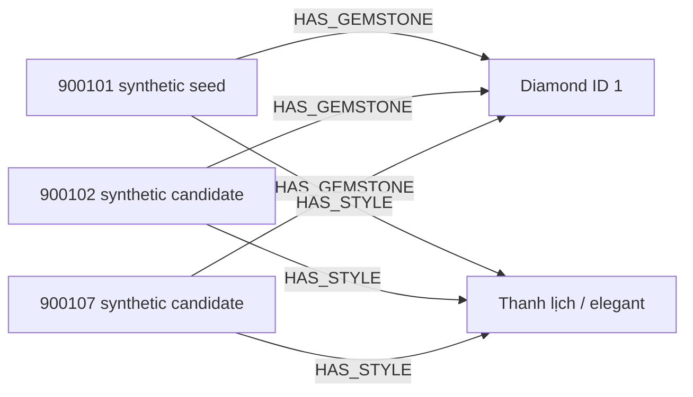

# Kịch bản minh họa và câu hỏi bảo vệ

Đây là kịch bản tái lập; chưa có bản quay demo UI hoặc screenshot Neo4j Browser.
Evidence thực thi là JSON live acceptance và logs tests. Không công bố điểm quality
từ fixture hoặc 136 câu đang PENDING_REVIEW.

## Ba tình huống đã có đường chạy test

1. Catalog gốc: "nhẫn bạc dưới 8 triệu". Model multilingual thật → Qdrant cosine +
   lexical + Neo4j → RRF → kiểm lại catalog → 3 product IDs thật. Xem `real_catalog_hybrid`
   trong report; không gán thêm giới tính/phong cách chưa có bằng chứng.
2. Fixture có evidence: "nhẫn cho con gái 8 tuổi". Trỏ female_child, chỉ trả 900104,
   báo chỉ có 1 trên 3 yêu cầu. Fixture nữ chung không thay thế chứng cứ phù hợp trẻ em.
3. Graph recommendation: "cùng đá và phong cách với sản phẩm #900101". Hai peer
   900102/900107 cùng Diamond và Thanh lịch; loại seed, hết hàng, hidden, sai đá/phong cách.
   Report chứa source/target IDs và paths truy vấn thật. Tắt giả lập graph adapter thì
   trả degraded_sources, không khẳng định có path vừa truy vấn.

Diagram minh họa đúng path JSON đã thu, không phải screenshot Browser. Có thể dùng
Cypher trong `knowledge-graph-schema.md` trên graph test để chụp hình trước bảo vệ.

## Câu hỏi thường gặp

| Câu hỏi | Trả lời có giới hạn |
| --- | --- |
| Graph được nhập thủ công không? | Không. Python parse/validate/UNWIND/MERGE/verify theo batch; live replay hai lần có counts ổn định. |
| Tại sao không tự gắn nữ cho nhẫn? | Dữ liệu nguồn chưa có evidence; loại sản phẩm không chứng minh đối tượng/độ tuổi. |
| Cosine là gì? | Dot chia tích norm; model normalize vector, Qdrant cấu hình Cosine. 384 là số chiều, không phải mức tương đồng. |
| Hybrid có cộng cosine và token count không? | Không cộng raw scores khác thang. RRF dùng thứ hạng, dense weight 2, sources khác 1; final tie ổn định. |
| Graph thay thế semantic không? | Không. Graph thêm facts/paths, dense cung cấp tín hiệu ngữ nghĩa; hard constraints ưu tiên hơn cả hai. |
| Top-K thiếu thì sao? | Không vượt K, không nới giá/đá/tồn kho để độn. Nếu thiếu thì báo số thực tế. |
| Làm sao tránh giá bịa? | Decimal từ catalog authoritative, đọc lại trước trả lời; template giữ IDs/rank/giá. CSV chỉ offline snapshot. |
| Có dùng LLM tự sinh SQL/Cypher không? | Không. Truy vấn có kiểm soát và parameters. Modular narrative hiện là template; Ollama mới chưa tích hợp. |
| PostgreSQL/graph/vector nhất quán tuyệt đối? | Chưa. Upsert replayable + readback, chưa có distributed atomicity/durable outbox/reconciliation hoàn chỉnh. |
| Điểm Precision/Recall hiện bao nhiêu? | Chưa công bố. 136 câu là ứng viên chưa người duyệt; evaluator chỉ tính APPROVED có reviewer. |
| Chứng minh quyền Admin/Staff thế nào? | Backend guards/owner tests và authenticated request; lời tự nhận trong prompt không cấp quyền. |
| Tách container có bảo đảm không ảnh hưởng nhau? | Chỉ giảm coupling. Docker fault matrix chưa chạy; PostgreSQL mất thì nghiệp vụ phụ thuộc DB vẫn bị ảnh hưởng. |

## Kiến trúc và phạm vi nghiệm thu

Cart: Router → CartService → repository Protocol → SqlAlchemyCartRepository.
AI: domain contracts → understanding/linking/planner → retrievers → fusion/reranker →
authoritative verification → grounded response. Composition root inject clients/model/repositories;
domain không import Neo4j/Qdrant/FastAPI. Runtime legacy vẫn giữ mặc định, modular opt-in.
Đây là Modular Monolith cho business boundaries cùng AI process độc lập, không chia business
thành microservices tùy tiện. Customer/Staff/Admin contracts được regression kiểm tra.

Trước bảo vệ cần: duyệt dữ liệu nguồn/benchmark, thu screenshot trên test graph,
chạy browser flows trên PostgreSQL staging, Docker build/fault recovery, và ghi hình demo.
Các việc này còn PARTIAL/PENDING_REVIEW/BLOCKED theo matrix, không được trình bày đã hoàn thành.
