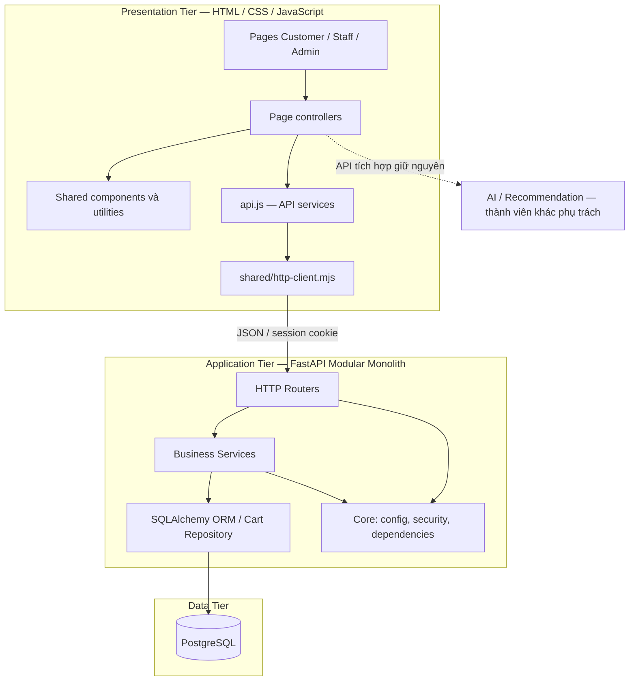
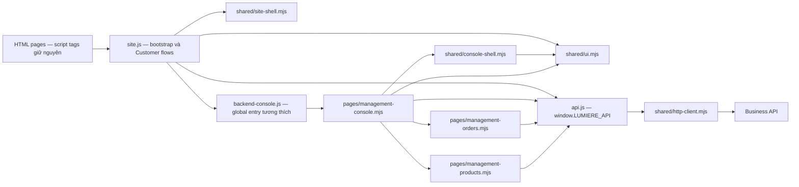

# LUMIÈRE — kiến trúc 3 tầng và refactor Business/Frontend

Ngày: 19/11/2026. Phạm vi: code hiện có trong `backend/` và `frontend/`.
Đây là bản ghi riêng cho Business/Frontend; không thay thế tài liệu hệ thống AI.

## Kiến trúc triển khai



Ba tầng là ranh giới triển khai; Router → Service → Data Access là các lớp bên trong
Business Backend, không phải thêm các tầng triển khai. Backend vẫn chạy một FastAPI
application. Không thêm microservice, framework frontend hoặc database mới.

## Backend và dependency map

| HTTP router | Nghiệp vụ | Data Access |
|---|---|---|
| `routers/auth.py` | `services/auth.py` | ORM User, Role, UserSession |
| `routers/catalog.py` | `services/catalog.py` | ORM Product và các bảng lookup |
| `routers/taxonomy.py` | `services/taxonomy.py` | ORM Category, Brand, Product |
| `routers/contact.py` | `services/contact.py` | ORM ContactMessage |
| `routers/orders.py` | `services/orders.py` hiện có | ORM Order, OrderItem, Cart, Product |
| `routers/cart.py` | `application/cart.py` hiện có | `infrastructure/cart.py`, ORM |
| `routers/payments.py` | `services/payments.py`, `payment_providers.py` | ORM hiện có |
| `routers/coupons.py` | `services/coupons.py` | ORM hiện có |
| `routers/customer_content.py` | `services/customer_content.py` | ORM hiện có |
| `routers/admin_customers.py` | `services/admin_customers.py` | ORM hiện có |
| `routers/admin_staff.py` | `services/staff.py` | ORM hiện có |
| `routers/dashboard.py` | `services/dashboard.py` | ORM hiện có |

Các đường dẫn trong bảng tính từ `backend/app/`. Services không import routers.
SQLAlchemy Session và ORM hiện có là lớp truy cập dữ liệu; không tạo repository cho
từng bảng chỉ để chuyển tiếp lời gọi. Cart giữ repository/domain riêng vì đã có test.

Router giữ nguyên decorators, tên hàm, request/response schemas, pagination,
dependencies và role guards. Auth router còn phụ trách set/delete HTTP cookie;
service phụ trách tài khoản, hash mật khẩu, phiên và persistence. Hằng cookie/TTL
đặt tại `core/security.py`. `core/dependencies.py` vẫn là nguồn xác thực/phân quyền.

Các validation schemas Contact/Taxonomy chuyển sang `schemas/contact.py` và
`schemas/taxonomy.py`, được import lại từ router để giữ callers hiện có. Các export
`auth.get_current_user`, `auth.hash_session_token`, `catalog.public_product_query`
và helpers Taxonomy/Orders vẫn tương thích.

Transaction, rollback, thứ tự lock, optimistic stock/price checks, error status và
nội dung response được giữ nguyên. Catalog tiếp tục dùng `services.orders.transaction`
và `lock_user` đang có để tránh thay đổi đồng thời quy tắc khóa và nghiệp vụ.
Không còn SQL/commit/rollback trực tiếp trong các Business routers không thuộc AI.

## Frontend và dependency map



`management-orders.mjs` giữ rendering, filter, pagination, xem chi tiết, chuyển trạng
thái và xác nhận COD dùng chung Admin/Staff. `management-products.mjs` giữ tìm kiếm,
form thêm/sửa sản phẩm và cập nhật tồn kho. Hai controller nhận API/UI helpers qua
factory function, không tạo class hoặc trạng thái toàn cục mới.

`management-console.mjs` điều phối trang và giữ các controller nhỏ còn lại.
`backend-console.js` tiếp tục đăng ký đồng bộ `window.LUMIERE_BACKEND_CONSOLE`;
controller thật tải qua dynamic import và được cache. Lỗi import có thông báo tại mount.
`site.js` tải shared modules trước bootstrap; event delegation và selectors giữ nguyên.

Shared UI gồm escape HTML, định dạng VND, error panel, site shell, role navigation
và console shell. `api.js` tiếp tục là API facade; HTTP client đang có được giữ lại
sau khi pass tests. Các file JS theo chức năng cũ giữ nguyên vì chưa có bằng chứng
đủ để xóa mọi references. Các Customer flows và phần legacy còn lại trong `site.js`
không bị viết lại chỉ nhằm giảm số dòng. Không thay HTML, CSS, URL hay script tags.

## Thay đổi và thành phần giữ nguyên

- Thêm `services/auth.py`, `catalog.py`, `contact.py`, `taxonomy.py`; mở rộng Orders
  service đang có. Không chuyển service cũ sang `application/`.
- Thêm 2 schemas Contact/Taxonomy, 3 page modules quản trị, 3 shared UI modules.
- Thêm fixture trình duyệt `backend/tests/serve_browser_fixture.py` và smoke runner
  `frontend/tests/browser-smoke.mjs`, sử dụng dependencies đang có và CDP native.
- `scripts/run_business_checks.py` thêm `--tests` để chạy targeted tests trong thư mục
  tests; giữ cơ chế chặn kết nối database persistent.
- Cart, models, migrations/schema, dữ liệu thật, API facade/HTTP transport hiện có,
  AI integration contracts và các services đã phù hợp được giữ nguyên.
- SHA-256 đối chiếu checkpoint xác nhận 147 file được bảo vệ không đổi, gồm `AI/`,
  models, HTML/CSS, CI/CD, Docker và hạ tầng hiện có. Thay đổi có sẵn trước phiên này
  trong những khu vực đó vẫn được bảo toàn, không được tính là công việc của refactor này.

## Kiểm chứng thực tế

| Lần kiểm tra | Kết quả |
|---|---|
| Baseline toàn bộ `backend/tests` | 640 passed, 827 subtests passed, 1 warning |
| Targeted Catalog/Admin Products/Orders/Cart/Taxonomy/Contact | 192 passed, 351 subtests passed |
| Targeted Auth/Profile | 8 passed, 22 subtests passed |
| Full regression cuối | 640 passed, 827 subtests passed, 1 warning |
| OpenAPI trước/sau | JSON bằng nhau hoàn toàn: 60 paths, 74 operations |
| HTTP client Node unit tests | 5 passed |
| Chrome headless trên fixture SQLite memory mới | 15 checks passed, 0 uncaught exceptions |
| Imports/module loading | Python compilation, Node syntax checks và browser dynamic imports thành công |
| `git diff --check` trong phạm vi thay đổi | Không lỗi |

Browser smoke thực thi đăng ký, đăng nhập Customer/Staff/Admin, profile, wishlist,
Cart tăng số lượng, checkout COD, lịch sử đơn, kiểm tra HTTP 403, logout, Staff xem
chi tiết/tìm đơn/chuyển trạng thái/cập nhật tồn và Admin sửa tên/giá. Toàn bộ trang
quản trị được kiểm tra tải module và render; không tuyên bố đã thử mọi thao tác CRUD
trên từng trang. AI bị chặn trong browser test để kiểm tra Business UI hoạt động độc lập.
API/RBAC/transaction failure cases được kiểm tra bằng bộ backend regression.

Lệnh tái chạy từ workspace root (dùng Python/Node có sẵn trong máy):

```powershell
.venv\Scripts\python.exe scripts/run_business_checks.py --sqlite-bootstrap --pytest --openapi .cache/refactor-openapi-after.json
.venv\Scripts\python.exe scripts/run_business_checks.py --sqlite-bootstrap --pytest --tests test_auth_profile.py test_catalog_api.py
.cache\node.exe --experimental-test-isolation=none --test frontend/tests/unit/*.test.mjs
```

Node không nằm trong PATH trên máy này. Chế độ runner mặc định bị `spawn EPERM`
trong sandbox; dùng `--experimental-test-isolation=none` chạy thành công, không bỏ test.

Browser smoke cần **fixture mới mỗi lần chạy**: mở terminal riêng chạy
`.venv\Scripts\python.exe backend/tests/serve_browser_fixture.py`, rồi mở Chrome
headless với `--remote-debugging-port=19222` và profile riêng trong
`.cache/refactor-browser`. Chạy `.cache\node.exe frontend/tests/browser-smoke.mjs`.
Kết thúc fixture bằng Ctrl+C; database memory tự mất. Không chạy fixture trên dữ liệu thật.
Một lần tái chạy trên fixture đã dùng gặp trạng thái wishlist cũ; sau khi khởi động
fixture mới, toàn bộ 15 checks pass. Đây là điều kiện cô lập test, không sửa nghiệp vụ.

Bằng chứng cục bộ: `.cache/refactor-openapi-{before,after}.json` và
`.cache/refactor-browser-evidence/result.json` cùng 4 screenshots.
Chưa kiểm chứng: PostgreSQL thật và concurrency/row locks trên PostgreSQL, thanh toán
VNPay end-to-end, AI/model thật và pixel comparison tự động với ảnh baseline.
Không cài Playwright dependencies; smoke thực tế dùng Chrome/CDP có sẵn.

## Checkpoint và rollback

Branch: `refactor/business-frontend-20261119`, tách từ
`feature/ai-admin-staff-enhancement`, giữ nguyên working changes.
Checkpoint trước refactor: `.cache/refactor-checkpoints/20261119-145319/` gồm
`workspace.zip` (1.409 files tracked/untracked không bị ignore), `manifest.json`
(SHA-256), `status.txt`, `head.txt`. ZIP đã kiểm tra CRC thành công.

`task-changes.json` cạnh checkpoint ghi file thay đổi/thêm trong phiên này và hash
trước/sau để phân biệt với thay đổi có sẵn. Checkpoint cuối nằm tại
`.cache/refactor-checkpoints/final-business-frontend/`.
Các bản lưu này ở local, không phải commit và không được push.

Rollback có chọn lọc: giữ bản sao working tree hiện tại, mở `task-changes.json`,
giải nén các bản gốc tương ứng từ checkpoint vào `.cache/rollback-review/` để diff.
Chỉ chép lại các file cần hoàn nguyên sau khi kiểm tra hash hiện tại còn trùng hash
cuối phiên; nếu khác, cần giữ lại thay đổi phát sinh sau này. File mới chỉ được bỏ
khi xác nhận không có sửa đổi/references mới. Không giải nén đè toàn repository,
không dùng reset/clean và không hoàn nguyên AI hoặc thay đổi có sẵn.
Rollback không cần migration hay thao tác database vì schema/dữ liệu thật không đổi.

## Việc còn lại khi có môi trường

Chạy regression trên PostgreSQL test riêng để xác nhận semantics lock/concurrency;
thử VNPay sandbox với cấu hình test. P2: kiểm tra references toàn bộ HTML/JS trước khi
dọn module legacy; không cần bước này để chạy các workflows đã kiểm chứng ở trên.
