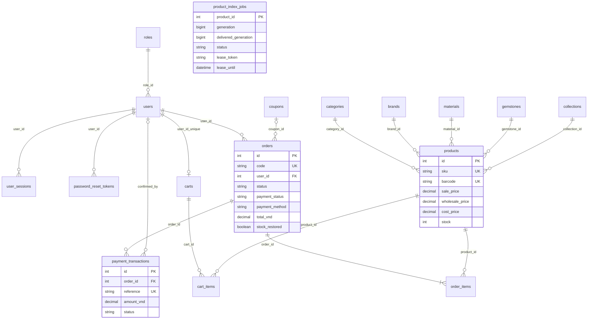
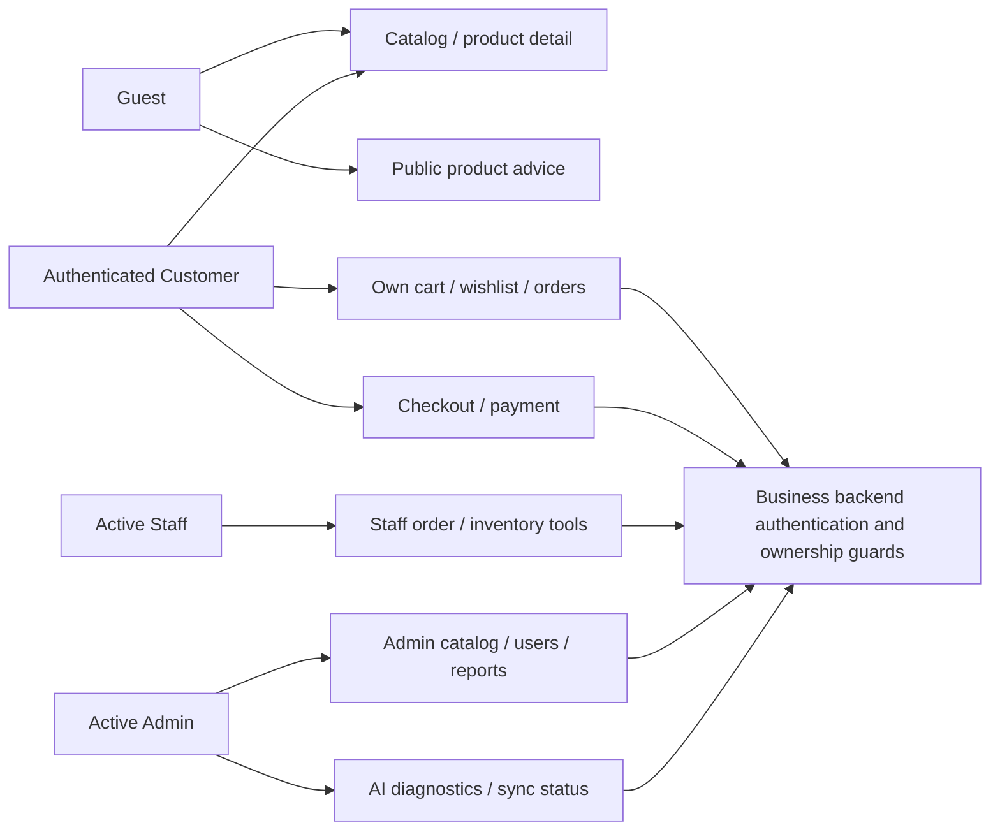
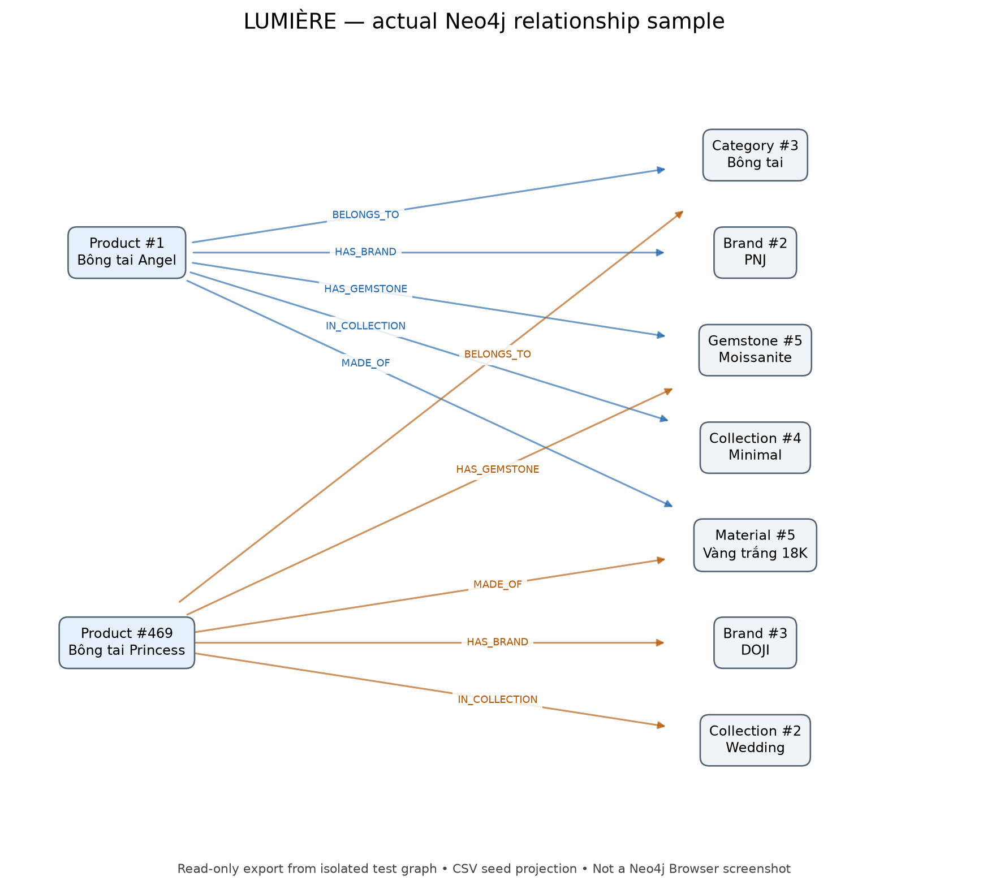

# Sơ đồ dựa trên source đã kiểm tra

Các hình là tài liệu source, không chứng minh mọi service đã deploy. AS-IS và TO-BE tổng thể ở `00-audit-as-is.md`. Phạm vi ERD dưới đây là core nghiệp vụ/identity/outbox, không tuyên bố toàn bộ schema. Dữ liệu Customer/Order không được đưa vào graph/vector product index.

## Core ERD

Nguồn: `backend/app/models/{user,role,user_session,product,cart,cart_item,order,order_item,payment_transaction,product_index_job}.py`, `backend/app/routers/password_reset.py`. Tên cột dùng đúng source; các FK taxonomy có `RESTRICT`, session/cart có `CASCADE`. Outbox không có FK Product để giữ yêu cầu tombstone sau xóa.



`orders ||--|{ order_items` mô tả invariant tạo đơn của service, không phải FK bắt buộc ít nhất một child ở mức SQL. Outbox `product_id` có cùng namespace Product nhưng chủ ý không vẽ FK vật lý. `confirmed_by` nullable; unique payment composite `(order_id,provider)` và `(provider,provider_transaction_id)` nằm trong model.

## Sequence: AI query đang triển khai

Nguồn: `AI/api.py`, `AI/rag/rag_service.py`, `AI/jewelry_agents/{intent_router,search_service,retrieval,ranking}.py`.

```mermaid
sequenceDiagram
    actor Customer
    participant API as AI API
    participant R as Intent + Query planner
    participant B as Business API
    participant Q as Qdrant
    participant N as Neo4j
    Customer->>API: POST /chat (query, top_k)
    API->>R: Validate input; route bounded intent
    alt Product query
        R->>R: Normalize, aliases/context, Top-K, constraints
        R->>B: Read current public catalog (timeout)
        B-->>R: IDs, names, prices, stock, taxonomy
        R->>R: Eligible IDs; resolve reference if needed
        R->>Q: Dense candidates within eligible IDs
        Q-->>R: Ranked IDs or explicit failure
        R->>N: Parameterized fact traversal
        N-->>R: IDs + actual paths or explicit failure
        R->>R: Lexical candidates + dedup + RRF
        Note over R: Optional experimental graph-feature rerank; off for Customer
        R->>B: Re-read authoritative catalog
        B-->>R: Latest facts
        R->>R: Revalidate reference, constraints, paths; final Top-K
        R-->>API: Verified products or explicit abstention/degradation
        API-->>Customer: Deterministic answer + compatible cards
    else Restricted or policy/order guidance
        R-->>API: Safe bounded route; no privileged public tool
        API-->>Customer: Verified policy or authenticated-page guidance
    end
```

Dense/graph lỗi có thể fallback, Business catalog không xác minh được thì fail closed. Sơ đồ không ghi LLM narrative đang chạy: nhánh V2 hiện dùng deterministic grounding, legacy CrewAI còn để tương thích.

## Sequence: CSV ingestion bằng code

```mermaid
sequenceDiagram
    actor Developer
    participant CLI as knowledge_graph/import_data.py
    participant V as csv_validation.py
    participant W as graph_writer.py
    participant N as Isolated Neo4j
    Developer->>CLI: Explicit CSV + dry-run/report
    CLI->>V: DictReader, NFC, Decimal, IDs/FKs, duplicates
    V-->>CLI: Valid records + errors + lineage
    alt Read-only default or validation failure
        CLI-->>Developer: JSON report; no writes
    else Explicit isolated dev/test, backup and confirmation
        CLI->>W: Validated batches
        W->>N: IF NOT EXISTS constraints
        loop Bounded batch writes
            W->>N: Parameterized UNWIND + MERGE stable IDs
            N-->>W: Transaction commit or rollback/retry
        end
        W->>N: Counts, duplicates, edge invariants
        N-->>CLI: Actual verification
        CLI-->>Developer: Import/verification report
    end
```

Replay không tạo ID mới; không CSV Customer/Order. Catalog seed không được ghi ngược giá/tồn kho vào DB nguồn.

## Sequence: outbox và worker

```mermaid
sequenceDiagram
    participant B as Business ORM
    participant P as PostgreSQL
    participant W as Index worker
    participant N as Neo4j
    participant Q as Qdrant
    B->>P: Product/taxonomy change + outbox generation
    Note over B,P: Cùng transaction; rollback cả hai
    W->>P: Short transaction: claim SKIP LOCKED + lease token
    P-->>W: ProductID + claimed generation
    W->>P: Read current public-only snapshot; close session
    W->>N: Idempotent graph upsert or tombstone
    W->>Q: Versioned embedding upsert or point delete
    alt Both delivered
        W->>P: Ack matching lease/generation
        Note over W,P: Concurrent newer generation remains pending
    else Partial failure or lease lost
        W->>P: Bounded backoff/retry/dead state; preserve newer work
    end
```

Không có distributed transaction/exactly-once. Retry hướng tới hội tụ; final live verification bảo vệ serving khỏi projection stale. Worker write có guard backup target/checksum; chưa bật trên DB đang dùng.

## Use cases theo quyền



Đây là use-case view bằng flowchart Mermaid, không nhận là UML formal đầy đủ. Role không lấy từ lời nhắc “tôi là admin”; backend session/active-role guards quyết định. Native browser đã kiểm tra diagnostics không cho guest/customer/staff.

## Graph instance có bằng chứng



Ảnh PNG/SVG tạo bởi `scripts/plot_graph_sample.py` từ `graph-sample-live.json`: 9 node, 10 cạnh export thật, có SHA256 nguồn tại `graph-sample-render.json`. Không tạo fact bằng tay; không phải ảnh Neo4j Browser. Product 1 và 469 chia sẻ Category 3, Gemstone 5, Material 5; Brand/Collection khác nhau. Không có Style/Audience được suy diễn.
