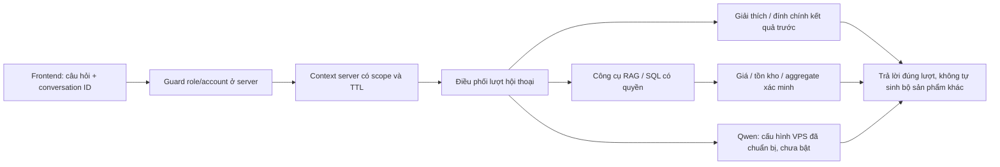

# Hội thoại theo ngữ cảnh và phần LLM cần triển khai

Ngày đối chiếu: 22/11/2026. Yêu cầu là trò chuyện tự nhiên cho Customer/Staff/Admin, không tự biến mọi câu thành danh sách sản phẩm. Không cam kết model nhỏ tương đương ChatGPT hoặc trả lời đúng mọi câu hỏi.

## CURRENT / CHANGE

- Trước đây `/chat` chỉ nhận một query, không có liên kết tới kết quả trước. Các câu hỏi mới mặc định đi vào product search, nên hỏi lý do lại tạo danh sách khác.
- `shared/conversation.py` giữ ngữ cảnh phía server, token ngẫu nhiên và scope theo role/account. Frontend cả ba role gửi lại conversation ID. Client không được tự đặt vai trò để cấp quyền. Context có TTL 30 phút, tối đa 256 cuộc/process và 6 lượt lịch sử; không ghi DB hoặc log câu hỏi. State mất khi process restart; token frontend hiện chỉ giữ trong trang, chưa có lịch sử lâu dài như ChatGPT.
- Giải thích kết quả trước dùng đúng snapshot trước, không truy xuất bộ sản phẩm khác. Phản hồi không yêu cầu sản phẩm không sinh thẻ mới. Câu hỏi kiến thức có tên loại trang sức cũng không mặc định là lệnh mua sắm. Đây là các đường xử lý/fallback đang hoạt động; không coi chúng là mô hình hội thoại tổng quát.
- Công cụ SQL/RAG và RBAC cũ được giữ. Scope private ràng buộc user ID đã xác thực; token cuộc trò chuyện không thay session login. Mỗi cuộc chỉ xử lý một lượt, yêu cầu trùng trả busy thay vì xếp hàng chặn thread. Toàn bộ dữ liệu sản phẩm/đơn/tài khoản cũ được giữ.
- Lớp `shared/local_dialogue.py` đã chuẩn bị cho Qwen local: lịch sử có giới hạn, role do server cung cấp, HTTP chỉ tới host local/Ollama, chặn cloud URL/proxy/redirect, model không có công cụ thực thi SQL. SourceGate chỉ cho một request model, timeout/cooldown/fallback. **Chưa bật và chưa kiểm model thật cho lớp này.** Adapter hiện hỗ trợ các câu trao đổi/ngoài công cụ; chưa là agent lập kế hoạch công cụ tùy ý hoặc hoàn chỉnh sinh lời giải cho mọi kết quả RAG.
- Warmup embedding có giới hạn khi khởi động. Nếu nguồn chưa sẵn sàng và không có candidate, câu trả lời nói rõ gián đoạn thay vì kết luận sai là không có sản phẩm. API thuộc tính review vẫn tắt mặc định cho đến khi migrate/nối đầy đủ; không query bảng mới trên DB 0009.

## TEST / COMPATIBILITY

- Full backend: **675 test và 829 subtest đạt**, log `.local-tmp/conversation-backend.log`; không dùng DB thật trong test này.
- AI/unit adapter/context/cache: **100 đạt, 1 skip**, `conversation-context-model-tests-20261122.json`; một graph integration được skip theo guard của bộ offline. Mock provider chỉ kiểm contract Qwen, không nhận là đã thử Qwen thật.
- `conversation-browser-20261122.json`: 5 scenario bằng Chrome thật đã đạt: đúng ba lượt Customer người dùng báo, câu trao đổi không thành product search, context Admin và Staff. Không inject API config hoặc mock response thành công. Customer dùng bản đang phục vụ 18080; management dùng QA copy 500 sản phẩm/12 đơn ở 18081, không reset tài khoản cũ.
- Lượt browser đầu gặp 0 candidate lúc model cold. Script cuối kiểm model thật sẵn sàng qua diagnostic của tài khoản QA Admin trước scenario, ghi số lần readiness vào `conversation-browser-final-20261122.json`. Đây không phải nghiệm thu cold-start/SLA hoặc chất lượng general dialogue.
- Lượt restart tiếp theo còn gặp 502 trước QA readiness và danh sách rỗng ở lần đầu encode prototype. Đã thêm health precondition, cache 8 mô tả công khai theo encoder (không cache câu hỏi người dùng), warm cả weights/kernel/prototype trong một task. Lượt browser cuối **5/5 đạt**, QA/model đều readiness trong một lần kiểm. Không bỏ guard timeout, đổi model, tăng K hoặc bịa candidate để làm test đạt.
- Test scope canary chứng minh token Admin không tái dùng được để lấy context của account/role khác. Không cộng các lượt test thành tổng số tình huống độc lập.

## VPS đã được người dùng chọn, trần 300.000đ/tháng

`compose.dialogue.yaml` chuẩn bị Ollama riêng, không public port; network dialogue riêng nối Business/AI, giữ network DB riêng. Chỉ một model/một request song song, giới hạn 3 GiB/2 CPU cho Ollama. `qwen2.5:3b`, context 2048, output tối đa 128 token là cấu hình khởi điểm để đo, chưa là cam kết chất lượng/tốc độ. Budget model tối đa 40 giây; riêng proxy management chat có timeout 50 giây, không kéo dài các request mua sắm thông thường. Profile này chưa được bật trên máy Windows đang thiếu RAM.

Đã validate Compose, network merge và `nginx -t`; **chưa chạy model/container LLM trên VPS, chưa mua host hoặc public deploy**. Tổng hạn mức memory của container không có nghĩa RAM sử dụng thực; phải đo cả worker, embedding, graph, DB và model cùng lúc trước nghiệm thu. Model không tự tải từ request chat; chuẩn bị weights trên VPS là bước quản trị riêng sau khi được duyệt.

Tra cứu nguồn chính thức: [VPS giá rẻ thường](https://client.vpsre.vn/index.php?rp=/store/vps-platinum-viet-nam) niêm yết 3 vCPU/6 GB/70 GB từ 250.000đ/tháng. [Danh mục giá rẻ](https://client.vpsre.vn/index.php?rp=/store/vps-viet-nam-platinum-gia-re) niêm yết 4 vCPU/8 GB/80 GB từ 259.000đ/tháng, nhưng liên kết đăng ký của gói này chuyển sang danh mục 8 GB/320.000đ. Do đó **chưa xác nhận mua được 8 GB/259.000đ**; không tự đặt gói vượt ngân sách. VAT, setup, IPv4, root/Docker, hệ điều hành và giá cuối vẫn phải đối chiếu trước thanh toán. Chỉ xem chu kỳ một tháng; không gửi yêu cầu hỗ trợ/email hoặc đặt mua thay người dùng.

## RISK / ROLLBACK / NEXT

- Context fallback không thay thế một LLM đủ năng lực. Chưa có nghiệm thu Qwen tiếng Việt, hallucination/grounding, bộ nhớ nhiều lượt đầy đủ, hoặc 100+ câu có người review. Các ví dụ người dùng đưa ra là regression, không là bằng chứng trả lời được mọi câu.
- Đổi lại source/image checkpoint trước nếu cần; context tạm có thể mất khi restart. Không reset mật khẩu, DROP, down-v hoặc xóa volume để rollback. Tắt `LUMIERE_DIALOGUE_LLM_ENABLED` để quay về công cụ/fallback nếu model lỗi. Không migrate hoặc downgrade review table chứa evidence khi chưa có checkpoint và review.
- Cần giá cuối/gói VPS trong trần và server được cấp. Sau đó chuẩn bị model trên Linux, restore dữ liệu qua kênh riêng, kiểm TLS, chạy bộ câu hỏi đa lượt/ba role và fault/latency/grounding thật trước khi công bố chất lượng. Cấp quyền SSH bằng cơ chế local an toàn; không gửi password/private key qua chat. Public activation và mua dịch vụ vẫn phải duyệt riêng theo mục 1.7 MASTER_PROMPT.
