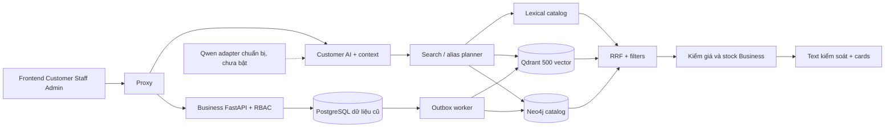
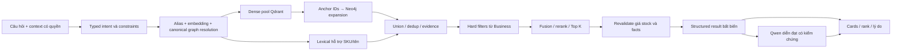

# Audit theo đặc tả mới — 22/11/2026

Baseline: `0684da518c5777945647ef403c06a61bd0c78a8f`, nhánh `rebuild/lumiere-demo-20261122`, working tree sạch lúc bắt đầu. Chưa sửa source/runtime/data trong lượt audit này. Tài liệu này được tạo sau bước kiểm chỉ đọc.

**Giới hạn:** đây là audit các đường thực thi chính và runtime, không tuyên bố đã review ngữ nghĩa từng file của toàn workspace. Inventory ban đầu có 264 file trong AI/backend app/shared/infra/workflows/scripts, chưa tính toàn frontend. Audit toàn bộ từng file vẫn mở. Kết quả test/CI lịch sử không được dùng để khẳng định runtime hiện tại đạt.

## 13 kết luận có nguồn

| Câu hỏi | Kết quả kiểm chứng | Source chính |
|---|---|---|
| 1. Customer AI | Frontend → proxy `/ai/chat` → `api.chat` → context server → RAG/intent → search → kiểm Business → câu trả lời/thẻ. Có hội thoại giải thích/đính chính nhưng nhiều nhánh còn deterministic. | `frontend/assets/js/app.js`, `customer-ai.js`, `AI/api.py`, `shared/conversation.py`, `AI/rag/rag_service.py` |
| 2. Qdrant | Runtime `jewelry_products_v_c0efd814ee4f`, 500 point. Payload: ProductID, ProductName, SKU, Category/CategoryID, Material, Gemstone/GemstoneID, Collection, embedding_fingerprint/model/revision, source_row/source_sha256. Không lấy giá/tồn kho trong vector làm nguồn bán hàng. | `AI/vector_index.py`, `AI/jewelry_agents/retrieval.py` + GET collection/scroll read-only |
| 3. Embedding | `paraphrase-multilingual-MiniLM-L12-v2`, revision `e8f8c211226b894fcb81acc59f3b34ba3efd5f42`, cache local. Query model chỉ tải file đã có, không tự download. | `compose.yaml`, `.env.example`, `get_dense_services()` |
| 4. Similarity | 384 chiều, Cosine. Version fingerprint gồm tên model/revision/dimension/cosine; từ chối schema khác. Dimension không phải điểm liên quan. | `index_identity()`, `index_products()`, `_search_qdrant()` + collection runtime |
| 5. Graph thực | Product 500, Category 6, Brand 4, Material 5, Gemstone 6, Collection 5. Mỗi loại BELONGS_TO/HAS_BRAND/MADE_OF/HAS_GEMSTONE/IN_COLLECTION có 500 cạnh, tổng 2.500. Sáu uniqueness constraint. Không có Audience/Style/Occasion/Feature đang chạy. | `schema.cypher`, `csv_validation.LOOKUPS`, Cypher read-only labels/type/count/SHOW CONSTRAINTS |
| 6. Tạo graph | Có importer Python validate CSV + lookup, UNWIND/MERGE, batch transaction, verify từng ID và đầu cạnh; worker chiếu từ PostgreSQL. Không cần tạo từng node bằng Browser. Chưa chạy lại import trong audit để bảo vệ dữ liệu. | `AI/knowledge_graph/csv_validation.py`, `graph_writer.py`, `AI/product_projection.py` |
| 7. Ngữ nghĩa/synonym | Normalization, alias versioned, phân biệt trẻ em qua context, tùy chọn cosine threshold/margin. Public search không truyền entity encoder; đường embedding entity linking hiện được bật qua diagnostics khi yêu cầu. Gift planner có embedding nhưng không phải full semantic entity resolution hay LLM hội thoại. | `entity_linking.py`, `aliases_vi.json`, `advice_planner.py`, `api.retrieval_diagnostics`, `rag_service.py` |
| 8. Top-K | Query Top 1–10; candidate mặc định `max(K*7,35)` (K=3 → 35). Lexical/dense/graph dedup, RRF `sum(1/(60+rank))`, lọc tiền/stock/thuộc tính; kiểm catalog lần nữa rồi sort và cắt K. Chưa benchmark pool size, trọng số hoặc relevance. | `search_service.search`, `ranking.py` |
| 9. Kết hợp graph/vector | Có thật, nhưng hiện là các nhánh ứng viên song song rồi fusion. Graph tìm theo entity hoặc sản phẩm tham chiếu; **chưa** có chuỗi tổng quát dense IDs → anchor graph expansion như đặc tả mới. Cùng đá/chất liệu/category có code; cùng Style/Audience/Occasion chưa đáp ứng. | `_graph_search_candidates`, `search_service.py`, `query_reference.py` |
| 10. Giữ/nâng cấp/thay | Giữ business/auth/payment, IDs/giá/tồn kho, CSV validator/upsert, outbox, versioned index, RRF, guards. Nâng cấp query schema, entity encoder public, anchor expansion, fact provenance, readiness/timeout, orchestration/generation. Không nhân đôi cây module hoặc thay model khi chưa có so sánh. | Các source ở bảng này và `backend/app/services/product_index_*` |
| 11. Docker | 10 service ứng dụng đang running; các healthcheck API/frontend/PG/Neo4j/proxy healthy ở thời điểm kiểm. Ollama profile chưa chạy trong stack này. Native Ollama có ở máy từ lượt trước không được coi là Ollama container đã tích hợp. | `compose.yaml`, `compose.original-data.yaml`, `compose.dialogue.yaml`, `docker compose ps` |
| 12. Rủi ro | Dense timeout/cooldown làm truy vấn phụ thuộc semantic rỗng; thiếu fact; graph writer hiện chỉ cho phép nhãn catalog, nên thêm node review đơn lẻ có thể làm worker từ chối. Reranker heuristic chỉ opt-in qua diagnostics; Qwen chưa live. RAM máy hạn chế. Test mock/smoke không chứng minh Precision/nDCG/faithfulness. | `shared/retrieval_limits.py`, `graph_writer.import_projection`, `reranking.py`, báo cáo evaluation hiện có |
| 13. Hướng xây mới | Giữ lõi nghiệp vụ, sửa availability có đo; schema query có validation; query embedding + canonical graph resolution; dense anchors → graph expansion; fusion/filter/rerank có chứng cứ; LLM diễn đạt riêng, không được đổi ID/rank/giá; nghiệm thu theo phase dưới. | TO-BE và kế hoạch dưới |

Tên cạnh legacy HAS_BRAND/IN_COLLECTION khác ví dụ PRODUCED_BY/PART_OF_COLLECTION nhưng có ý nghĩa tương ứng được code sử dụng. Không rename hoặc tạo cạnh song song chỉ để giống tên mẫu; cần migration/adapter có kiểm chứng nếu đổi.

## Lỗi người dùng báo — tái hiện trong audit

Diagnostic nội bộ được bảo vệ, không in token hoặc dòng khách hàng:

| Query | HTTP | Kết quả | Nguồn |
|---|---:|---|---|
| sinh nhật tặng gì | 200 | degraded, returned=0 | dense `SourceUnavailable: timeout`; lexical=0, graph=0 |
| Top 3 nhẫn dưới 8 triệu | 200 | degraded, returned=3 | dense cooldown; lexical=19, graph=19 |

SourceGate mặc định 3 giây, cooldown 15 giây, một task/source. Vì query sinh nhật không có category/gemstone trong graph và không có lexical hit, mất dense đồng nghĩa mất toàn bộ ứng viên. Không phải mất 500 sản phẩm/500 vector. Lượt này chưa đo tách encode/network/schema-check nên **chưa kết luận nguyên nhân gốc chỉ là RAM hoặc cache**. Windows còn 559.920 KiB khả dụng tại phép đo; đây là snapshot, không phải capacity benchmark.

Backend public catalog xác nhận 500 sản phẩm và chỉ trả các trường công khai. Audit không reset user, import, sửa chỉ mục, migrate hoặc đổi timeout. Cần sửa độ sẵn sàng trước khi tiếp tục nhận các demo semantic đã đạt ổn định.

## AS-IS

## TO-BE / GAP ưu tiên

- **P0:** availability/readiness dense, phân loại lỗi encode/network/cooldown, câu sinh nhật không keyword dưới cold/warm/repeated/concurrent; không sửa bằng tăng timeout mù hoặc lấy đại K sản phẩm.
- **P1:** typed query và canonical entity resolution trong đường public; nối reviewed facts qua catalog → outbox → graph/vector → filters. Worker/schema phải hỗ trợ nhãn mới trước khi bật review. Không tự suy ra nữ/thanh lịch/dịp lễ từ ảnh/tên.
- **P1:** Neo4j expansion từ dense anchors và path evidence; reference traversal riêng vẫn được giữ.
- **P1:** chọn/cân chỉnh reranker trên validation; debug score phải mang đúng ý nghĩa RRF/heuristic, không dựng semantic_score/graph_score giả.
- **P1:** Qwen/context/tool routing cho cả ba role, với RBAC phía server và structured IDs/rank/price bất biến; mock adapter chưa là nghiệm thu LLM.
- **P2:** fault matrix cả 5 dependency, benchmark có ground truth, security/staging/release/hosting và monitoring còn thiếu. Không mua/deploy trước khi chốt target/giá/quyền.

## Kế hoạch theo PHASE 0–10 của đặc tả mới

| Phase | Thực hiện tiếp / file chính | Gate phải đạt |
|---|---|---|
| 0 | Hoàn thiện coverage từng file và integration, cập nhật AS-IS/GAP | Phân biệt reviewed / exists-not-tested / missing; không nhận full audit khi chưa đọc |
| 1 | Giữ branch/checkpoint 0684da5, baseline tái lập trên copy, backup/ref | Old business flows không regression; dữ liệu gốc không ghi |
| 2 | Giữ CSV validator/writer; thiết kế overlay fact có nguồn và schema tương thích worker | Dry-run, import lại không duplicate, exact relationships và provenance |
| 3 | `entity_linking.py`, typed understanding schema, calibrated canonical candidates | Alias/paraphrase/adult-child/ambiguity; thiếu fact phải abstain đúng |
| 4 | `retrieval.py`, embedding lifecycle và source limits | Dense-only query có ứng viên hợp lệ; failure/recovery đo được; không trộn embedding |
| 5 | Graph adapter + anchor expansion | Anchor IDs thật, same-gem/material và reviewed attributes; paths có nguồn |
| 6 | `search_service`, `ranking`, `reranking`, response adapter | No duplicate, tối đa K, đủ K khi có candidate, live filters, không đảo rank bởi LLM |
| 7 | `rag_service`, context, local dialogue, verified evidence generator | Qwen thật trên target đủ tài nguyên; không bịa/đổi sản phẩm/giá/rank; role separation |
| 8 | Evaluation runner/labels/scorer cùng snapshot | Keyword/dense/graph/rerank/hybrid, chất lượng và latency thật; chưa có human labels thì không xuất quality scores |
| 9 | Compose/worker và failure scripts | AI/Qdrant/Neo4j/Ollama/PG failures, fallback/recovery, không xóa volume |
| 10 | CI/security/staging/Grafana/hosting/report | Target/chi phí được duyệt, TLS, backup/restore, smoke và rollback; production sau staging |

Mỗi thay đổi kế tiếp phải có CURRENT/CHANGE/TEST/COMPATIBILITY/RISK/ROLLBACK/DOCS/NEXT. Tests cũ 675 backend/100 AI pass và 5 browser context case là lịch sử có scope, không thay cho các gate còn mở ở đây. Chưa viết lại source trong lượt audit này và chưa đánh dấu hoàn thành toàn dự án.
