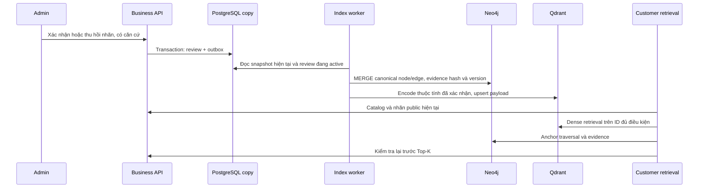

# Nhãn sản phẩm có căn cứ — local, 23/11/2026

Người dùng xác nhận chưa có bảng nhãn Audience/Style. Không gán giới tính/phong cách cho 500 sản phẩm bằng tên, ảnh hoặc điểm embedding. Bộ phiếu `.local-tmp/human-review-original-20261122` vẫn là phiếu trống, không phải ground truth. Nhãn trong bài integration là fixture QA, không được chuyển sang dữ liệu phục vụ khách.

## Phạm vi và luồng thực tế

Admin dùng `pages/admin/product-attributes.html` để chọn sản phẩm thật, chọn canonical label, ghi căn cứ và tự đánh dấu xác nhận. Backend kiểm tra phiên đăng nhập/quyền Admin, khóa hàng, lưu version/lịch sử và enqueue cùng transaction khi outbox bật. Thu hồi yêu cầu đúng version; lịch sử vẫn giữ.



Public catalog chỉ xuất label/canonical/name/hash căn cứ. Ghi chú, người duyệt và audit log chỉ có qua Admin API. Văn bản ghi chú không đưa vào embedding hoặc lời giải thích. Public fields không có khi feature flag tắt để giữ contract cũ.

Canonical nodes `Audience`/`Style` có unique constraints, owner riêng `lumiere-reviewed-attributes-v1`. Cạnh `SUITABLE_FOR`/`HAS_STYLE` chỉ active sau xác nhận. Thu hồi làm cạnh inactive và cập nhật vector; giữ lịch sử PostgreSQL. Dữ liệu CSV thiếu trường review không có quyền tự xóa overlay. Graph proof được so với nhãn/hash mới nhất từ Business API trên cả source và candidate.

## Kiểm thử và trạng thái

- Backend mới: **683 passed, 833 subtests**, 19 deprecation warnings, `.local-tmp/knowledge-routing-backend-tests.log` (528,55 giây trên máy thiếu RAM).
- AI/tools: **132 run, 131 passed/1 skip** server graph, `knowledge-routing-tests-20261123.json`. Gồm test kết thúc child process đang giữ pipe khi CLI timeout, tái sử dụng vector đúng query/model trong một request, và câu hỏi kiến thức không tự chuyển thành tìm sản phẩm. Đây không phải benchmark chất lượng.
- Migration QA: `review-schema-qa-20261123.json`; backup custom-format có checksum, 21 bảng có sẵn giữ nguyên trước/sau. Migration chỉ thêm bảng/index/constraints.
- Integration riêng đạt **8/8**: `reviewed-attributes-integration-20261123-r3.json`, graph/vector volumes `review_qa_*`, database `lumiere_test_ai_acceptance`, encoder pinned thật. Import/replay 4 sản phẩm QA giữ 18 node/26 cạnh, 6 nhãn ban đầu đúng evidence; thu hồi Style loại sản phẩm khỏi query. Đây không phải graph phục vụ 500 sản phẩm, không phải benchmark chất lượng.
- Chrome riêng đạt **7/7** trên `127.0.0.1:18082`, QA-only accounts: `reviewed-attributes-browser-20261123-r2.json`.
- Giữ failure `reviewed-attributes-integration-20261123-r2.json`: giới hạn 300 giây và phục hồi Compose chờ health quá lâu. Lần mới chuyển batch, dọn runner có tên, restart đúng container trước; tất cả dịch vụ đã dừng được phục hồi trạng thái running, chưa suy ra semantic readiness từ trạng thái đó.
- Không đánh dấu hoàn tất outbox xuyên container, human relevance benchmark hoặc LLM từ các test xác nhận nhãn này.

Local phục vụ đã bật flag đồng bộ cả ba service, schema 0010, 500 sản phẩm PG/graph/vector, outbox 500 done, 8 constraints: `reviewed-attributes-serving-20261123.json`. Review store và review graph đều 0, không có fixture QA chuyển sang catalog phục vụ. Màn hình Admin: `http://127.0.0.1:18080/pages/admin/product-attributes.html`. Chưa có nhãn thực tế, truy vấn cần giới tính/phong cách phải báo thiếu evidence thay vì tự gán.

Sau restart có lỗi readiness được giữ riêng trong các report `reviewed-facts-conversation-browser-*`. Probe nội bộ thật trả `ok` với 35 kết quả ở mỗi nguồn, nhưng tổng khoảng 20,7 s vượt deadline 15 s tại Business diagnostics (`reviewed-ai-budget-observation-20261123.json`). Đã đổi riêng AI diagnostics sang connect/read 3/30 s (read cho phép 3..40), proxy AI 50 s, caller kiểm thử 40 s. Không đổi timeout route nghiệp vụ thường. Test browser chỉ được coi đạt khi có report thành công riêng.

Healthcheck API có thêm thời gian khởi động interpreter, giữ HTTP timeout 3 s; Neo4j vẫn dùng truy vấn có xác thực, chuyển interval/timeout 60/30 s để tránh khởi động Java lặp quá dày trên lab 8 GB. Đây không phải chứng minh SLA hoặc hoàn tất load test.

Lỗi Playwright có thể chứa Cookie trong call log. `scripts/browser/secure-failure.cjs` chỉ lưu chi tiết cạnh fixture QA có ACL riêng, report/console chỉ có loại lỗi và phase. `test-secure-failure.cjs` dùng marker giả đã đạt; CI chạy cùng test này. Không commit log chi tiết hoặc fixture.

Đối chiếu dữ liệu gốc mới nhất đạt: `original-project-reviewed-facts-20261123-r3.json`, 19 bảng nghiệp vụ giữ nguyên digest, 13 sequence gốc khớp, 500 ảnh khớp byte qua HTTP. Phiên đăng nhập có vòng đời hợp lệ; không reset tài khoản. Hai lần probe clone chưa sẵn sàng vẫn được giữ bằng report lỗi, không tính là thành công.

Hội thoại Chrome trước thay đổi knowledge routing đạt 5/5 (`reviewed-facts-conversation-browser-20261123-r4.json`): sinh nhật → giải thích giữ nguyên sản phẩm → sửa ý không thêm card → câu hỏi chung; role/UI đạt 13/13 (`reviewed-facts-roles-browser-20261123.json`). Những bài này không chứng minh Qwen đã chạy.

## Chạy lại QA

Migration cần image mới, Docker Engine và backup gốc đã xác minh. `scripts/migrate_review_schema.py --database qa --confirm-local-test --report <file-mới.json>` từ chối ghi đè thư mục backup/report. Mốc QA đã migrate thì không chạy lại bước backup với cùng thư mục.

```powershell
python -B scripts/run_review_acceptance.py --report docs/reviewed-attributes-integration-NEW.json
$env:NODE_PATH='D:\LUMIERE-FINAL-TEST\.local-tmp\browser-tools\node_modules'
node scripts/browser/verify-product-attributes.cjs .local-tmp/original-db-20261122-014434/ai-acceptance/fixture.json docs/reviewed-attributes-browser-NEW.json
```

Runner kiểm tra target/volume, tạm dừng những dịch vụ AI/monitoring đang chạy để tiết kiệm RAM, luôn thử khôi phục chúng trong `finally`. Website/Business/PostgreSQL không bị dừng. Không chạy hai bài retrieval cùng lúc. Runner để UI QA lại cho test trình duyệt; graph/vector QA dừng sau bài thử, không xóa volume.

Suite Qwen riêng được chuẩn bị trong `compose.dialogue-acceptance.yaml` và `scripts/verify_dialogue_acceptance.py`. Chạy bằng `run_review_acceptance.py --suite dialogue --model-cache <cache-model-có-sẵn> --report <file-mới.json>`. Cache model mount read-only; suite không tải model hoặc thay cấu hình LLM của bản phục vụ. Nó kiểm tra model thật cho ba role, ngữ cảnh tiếp nối, tắt/bật provider và số đơn SQL. Chỉ report `successful: true` mới là bằng chứng đạt. Đây là QA cô lập, không phải full hybrid + LLM cùng chạy hoặc đánh giá chất lượng của con người.

## Bật trên bản sao local và rollback

Chỉ sau integration đạt: tạo backup riêng với `--database serving-copy`, migrate bản sao `lumiere_test_original_data`, rồi chạy Compose kèm `compose.verified-attributes.yaml`. Không tác động database nguồn cũ. Flag phải đồng bộ ở Business/AI/worker; startup Business từ chối bật khi thiếu bảng review. Không tự tạo nhãn trên bản sao phục vụ khách.

Rollback ưu tiên: tắt flag ở Business/AI/worker và giữ image mới tương thích graph; giữ bảng review, audit, graph/vector và backups. `scripts/checkpoint_review_runtime.py` chuẩn bị override trong `.local-tmp/review-runtime-checkpoint-20261123`, có image baseline từ worktree Git `f4a7a6a` nếu image cũ không còn truy xuất được. Không publish các checkpoint local. Rollback toàn bộ image baseline chỉ phù hợp trước khi graph có node nhãn review; worker baseline cũ không chấp nhận Audience/Style. Khi đã có nhãn, dùng rollback flag hoặc giữ worker mới. Không downgrade bảng đã có evidence, không restore đè lên thay đổi mới của người dùng. Khôi phục DB khi thật sự cần phải dùng bản sao khác và đối chiếu trước, không xóa dữ liệu hiện có.

Vẫn còn ngoài phạm vi phase này: Audience/Style do người có trách nhiệm xác nhận, Occasion có evidence, entity linking semantic public đầy đủ, Qwen hội thoại live, benchmark/ablation ground truth, full checkout/payment UAT và triển khai hosting. Người dùng chọn tiếp tục local, chưa thuê VPS.
