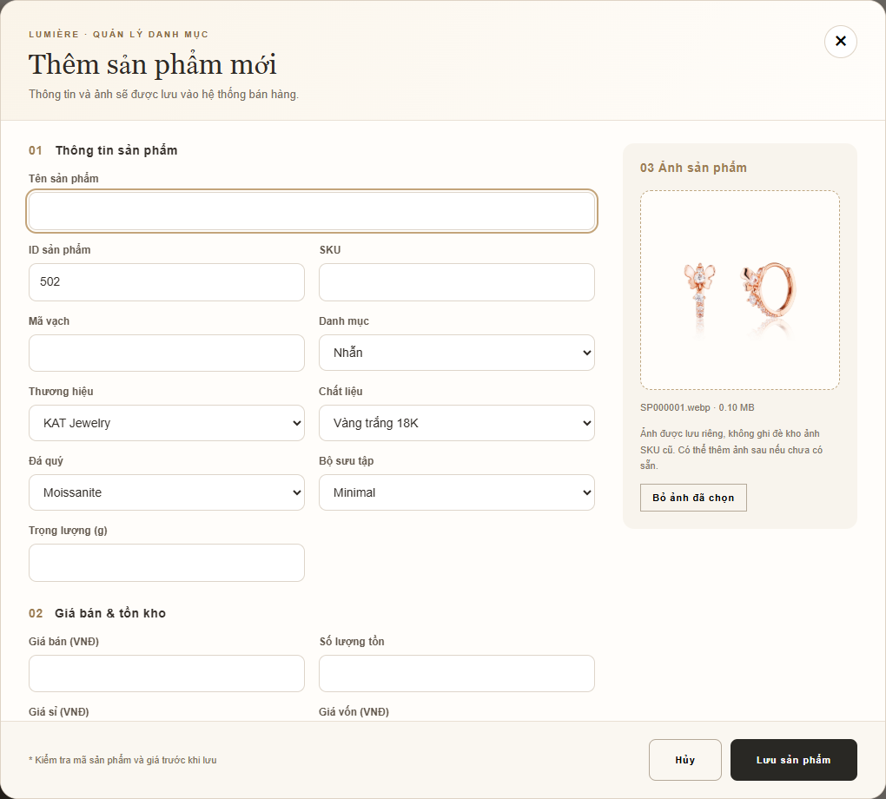

# Sửa checkout, VNPAY và form sản phẩm — 23/11/2026

Đã cập nhật bản local tại **http://127.0.0.1:18080**. Nếu trang đang mở, bấm **Ctrl+F5** để nhận JavaScript/CSS mới.

## Mã giảm giá

- Checkout có nút **Áp dụng mã**, **Bỏ mã**, dòng tiền giảm và tổng thanh toán mới theo API.
- Nếu chỉ nhập mã rồi bấm đặt hàng, hệ thống tự kiểm tra và áp dụng; không còn bắt buộc bấm kiểm tra riêng trước.
- Khi sửa/xóa mã trong ô nhập, mức giảm cũ bị bỏ. Phản hồi kiểm tra cũ không được ghi đè mã vừa thay đổi.
- Mã không tồn tại, hết hạn, chưa hiệu lực, hết lượt, đã dùng hoặc chưa đạt đơn tối thiểu có thông báo tiếng Việt. Không bỏ qua quy tắc Backend để nhận mọi mã.
- Trang `/pages/admin/coupons.html` có form tạo/sửa mã, ngày giờ địa phương tự đổi UTC, mức giảm tối đa và giới hạn lượt dùng. Có thể chỉnh thời hạn của mã qua Admin; không tự sửa thời hạn hoặc lượng sử dụng của mã cũ.

## VNPAY cũ

Cấu hình gốc vẫn ở `.env`. Trước đây container chạy từ `.env.example` và không nhận biến VNPAY. Đã chọn riêng bốn biến VNPAY vào file bỏ qua Git `.local-tmp/local-commerce/vnpay.env`, giữ nguyên giá trị gốc, không nạp mật khẩu database cũ vào container và không ghi đè `.env`.

Overlay `compose.payments-local.yaml` nạp cấu hình riêng tư. Khả năng VNPAY trên bản local đã được kiểm tra `enabled: true`; giao diện cho chọn **VNPAY Sandbox**. Proxy nhận cả đường callback cũ `/payments/vnpay/return`, `/payments/vnpay/ipn` và đường có tiền tố `/api/`. HTTPS/signature/amount/ownership checks vẫn giữ.

**Chưa kiểm chứng giao dịch ngân hàng đầu cuối hoặc IPN thực tế.** URL callback HTTPS cũ phải còn hoạt động và trỏ tới ứng dụng đang chạy. Bài kiểm thử chỉ tạo và kiểm chữ ký URL Sandbox bằng merchant giả trong database QA, chặn điều hướng ra ngoài; không gửi thanh toán thật. Return chỉ hiển thị kết quả; IPN đã được kiểm chữ ký mới cập nhật trạng thái theo [tài liệu VNPAY](https://sandbox.vnpayment.vn/apis/docs/faqs/).

## Thêm sản phẩm và ảnh

Trang `/pages/admin/products.html` có form mới chia nhóm thông tin, giá/tồn kho và ảnh. Header/nút lưu giữ trong khung, phần nhập cuộn được trên desktop/mobile.

- Chọn hoặc kéo ảnh từ máy, xem trước, bỏ lựa chọn ảnh trước khi lưu.
- JPEG/PNG/WebP tối đa 5 MB và 16 megapixel. Server giải mã, chuẩn hóa thành WebP, loại metadata; không nhận SVG hoặc ảnh động.
- Ảnh được lưu trong volume `lumiere-rebuild-test_rebuild_product_images`, tách khỏi kho ảnh SKU cũ. Không thêm cột hoặc migrate database để lưu ảnh.
- Sau khi tạo sản phẩm, nếu ảnh lỗi, form giữ ID đã tạo và cho thử ảnh lại; không tạo trùng sản phẩm.
- Nút **Ảnh** ở mỗi dòng cho thay ảnh của sản phẩm đã có. Ảnh tải lên trước được giữ trong history; ảnh SKU gốc không bị sửa.
- Chỉ Admin được tải ảnh. API ảnh có request/response schema và lỗi có kiểm soát. Nếu không đọc được kho ảnh, catalog vẫn có thể dùng ảnh dự phòng.



## Kiểm chứng

- `commerce-backend-tests-20261123.json`: 233 test backend liên quan và 361 subtest đạt; không chạy lại bộ AI/model.
- `commerce-browser-20261123.json`: 7/7 ca Chrome thật: tạo sản phẩm/ảnh lỗi-thử lại, tạo mã, mã sai, áp/bỏ mã, tự áp khi COD, URL VNPAY có HMAC đúng và chặn Customer tải ảnh.
- `commerce-layout-20261123.json`: 2/2 kiểm bố cục desktop/mobile; không ghi dữ liệu.
- `commerce-main-verification-20261123.json`: website/API hoạt động, Main vẫn 500 sản phẩm, giá trị VNPAY khớp nguồn gốc, kho ảnh Main/QA khác nhau và ảnh SKU mẫu giữ nguyên byte.
- Test có ghi dữ liệu dùng **database mới** `lumiere_test_commerce_acceptance`, tạo bằng template QA cũ khi không có kết nối; không ghi Main hoặc sửa database nguồn. Ảnh QA có volume riêng.

## Khởi động lại và rollback

Trong workspace hiện tại, dùng lệnh này để giữ cấu hình VNPAY đã khôi phục:

```powershell
docker compose --env-file .env.example -p lumiere-rebuild-test -f compose.yaml -f compose.original-data.yaml -f compose.verified-attributes.yaml -f compose.payments-local.yaml --profile sync --profile monitoring up -d
```

Trên workspace mới, chỉ thêm overlay thanh toán sau khi có file cấu hình riêng tư hợp lệ; có thể chuẩn bị bằng `python -B scripts/restore_local_vnpay.py` với `.env` gốc. Không commit file riêng tư, không dùng merchant QA cho giao dịch thực.

Checkpoint source trước sửa: nhánh local `checkpoint/commerce-before-20261123` tại `c7a349d`. Hai image cũ còn giữ: `lumiere-commerce-before-business:20261123` và `lumiere-commerce-before-frontend:20261123`. Nếu rollback, pin hai image này bằng Compose override và `up -d --no-build --no-deps business-api frontend`; giữ nguyên database, volume ảnh, cấu hình riêng tư và backup. Không downgrade/drop database hoặc xóa `.local-tmp`.

Backup ảnh phải bao gồm volume `rebuild_product_images`, ngoài backup PostgreSQL. Giữ volume khi đổi/rebuild image; không dùng `down -v`. Cấu hình hosting có bốn biến VNPAY riêng, mặc định tắt đến khi cung cấp merchant/HTTPS phù hợp; chưa có public deployment.
